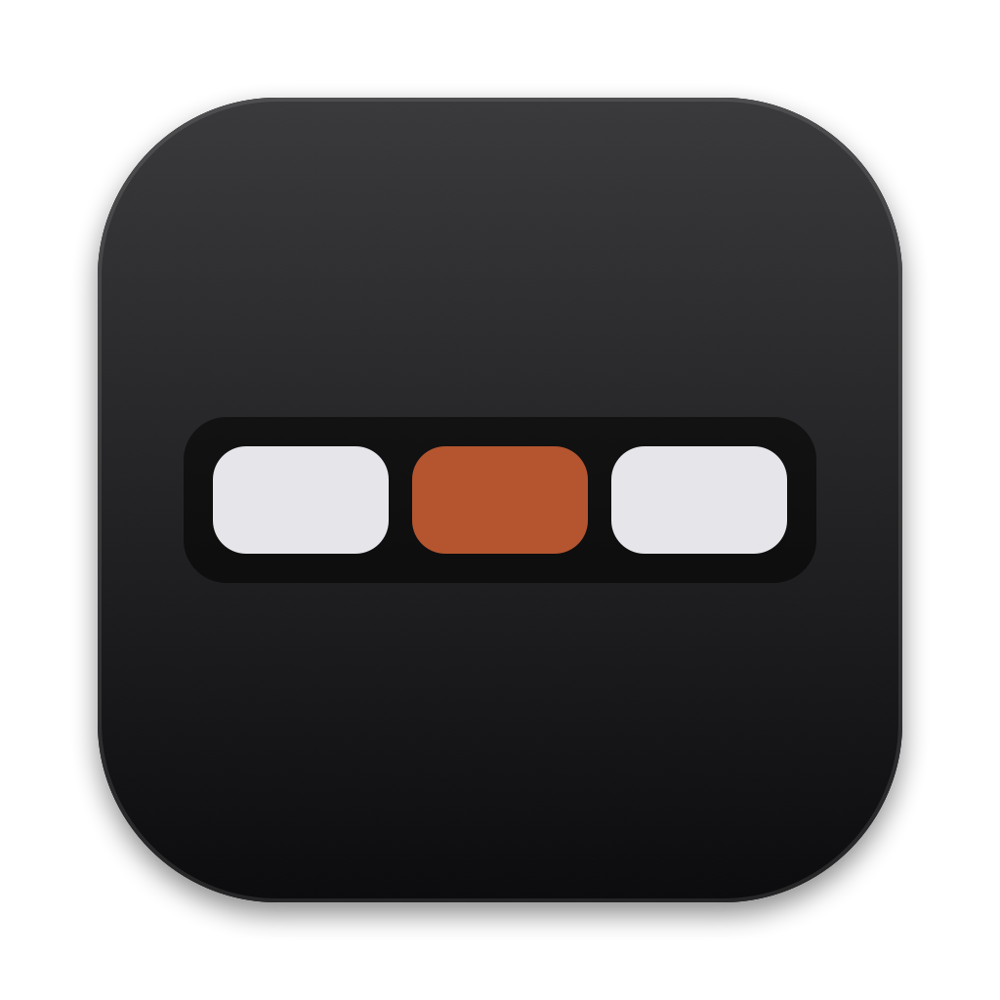
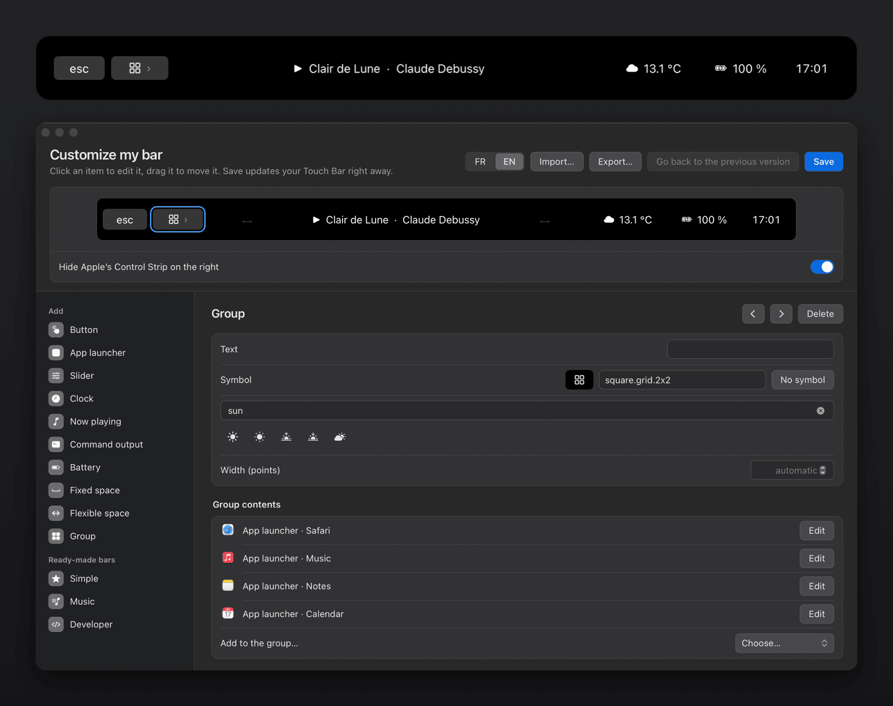
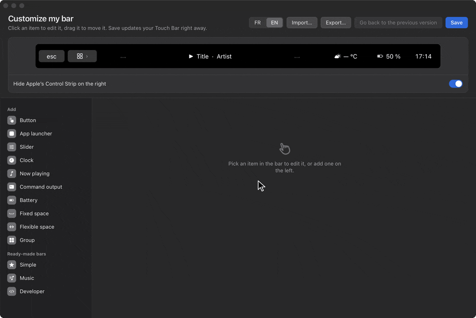
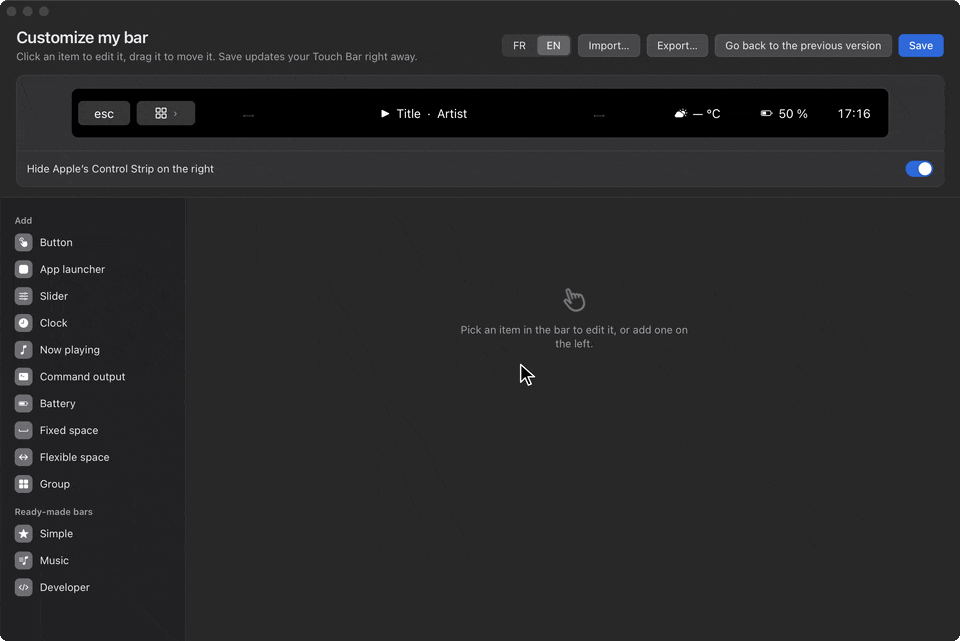
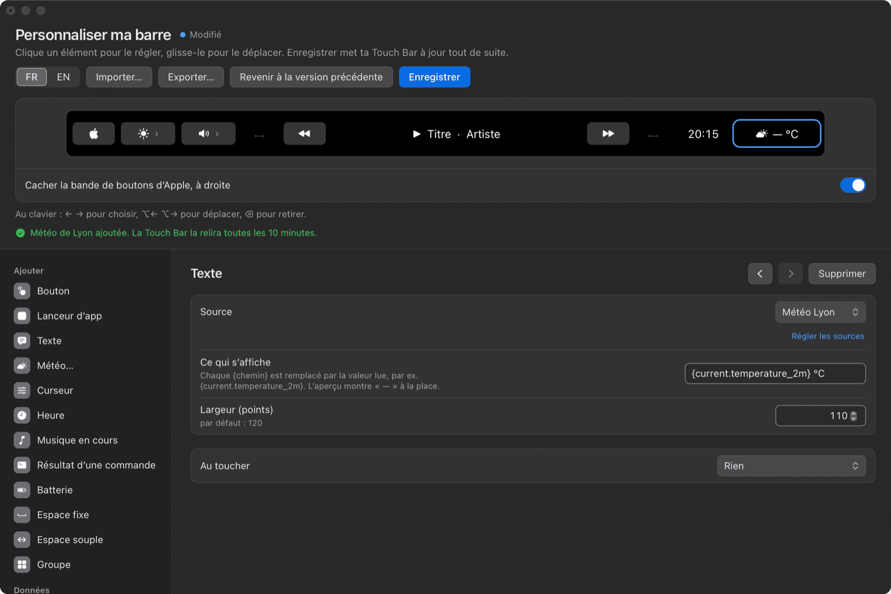
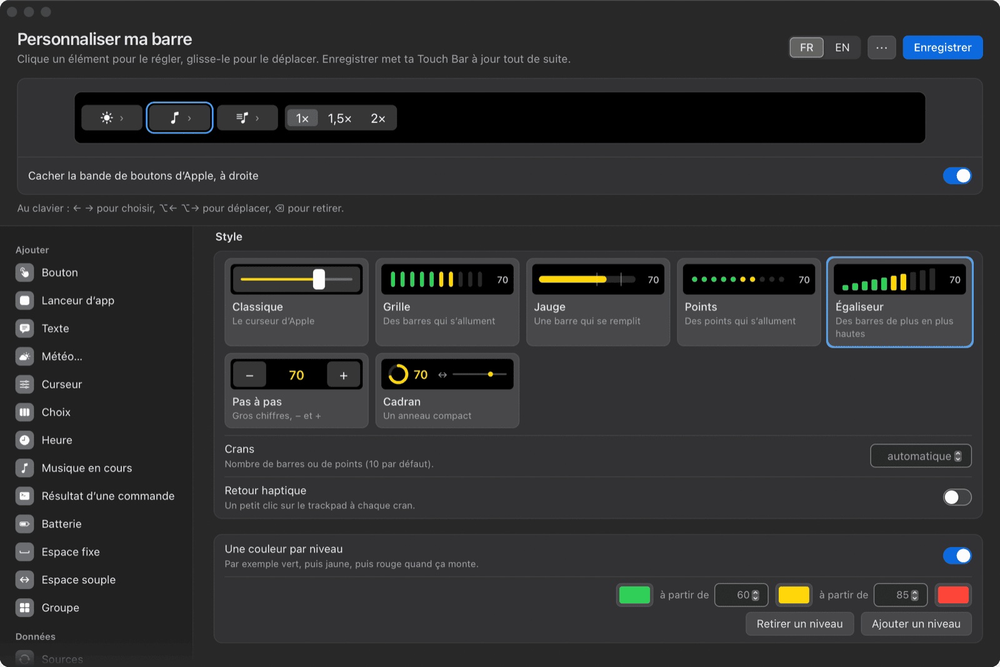
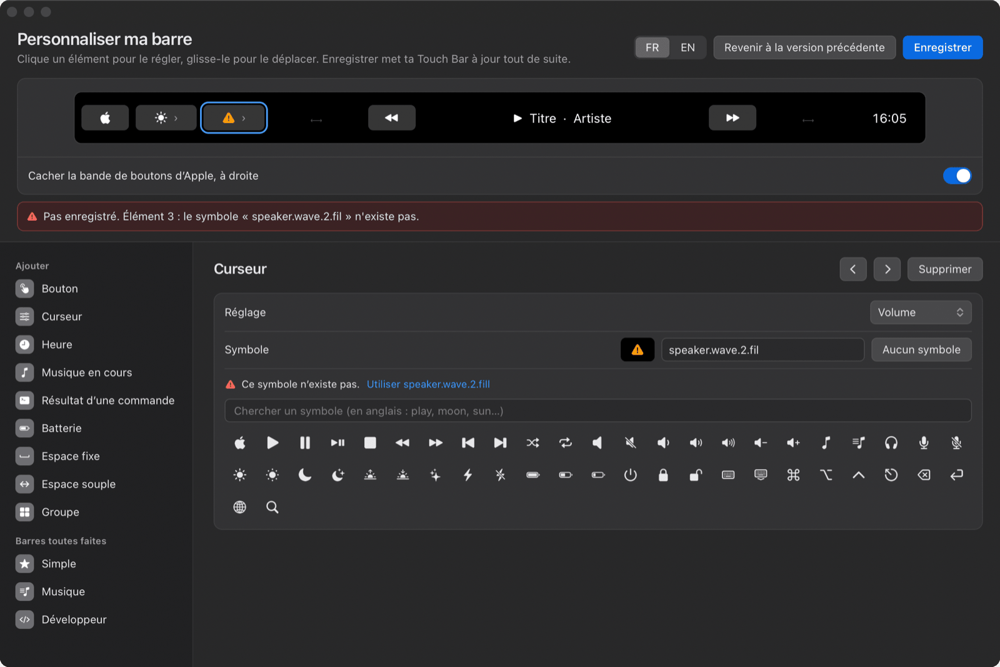

<p align="center">
  
</p>

<h1 align="center">Tactile</h1>

<p align="center">
  <strong>Une Touch Bar à ton goût, gratuite et open source, décrite dans un petit fichier texte ou réglée dans une fenêtre.</strong>
</p>

<p align="center">
  <a href="https://github.com/lepalph/tactile-touch-bar/actions/workflows/ci.yml"></a>
  <a href="https://github.com/lepalph/tactile-touch-bar/releases/latest"></a>
  <a href="LICENSE"></a>
  
</p>

<p align="center">🇬🇧 <a href="README.md">Read in English</a></p>

Tactile remplace la Touch Bar de ton MacBook Pro par la barre que tu décris : boutons, curseurs de luminosité et de volume, musique en cours, heure, commandes à toi. Tu passes de ta barre à celle d'Apple d'un toucher.



## En bref

- Ta barre tient dans `~/.config/tactile/barre.toml`, un bloc `[[element]]` par élément. Tu enregistres, la barre change dans la seconde. Une erreur laisse ta barre actuelle en place et donne la ligne à corriger.
- La fenêtre de l'éditeur (`tactile --personnaliser`) montre la Touch Bar à sa vraie taille. Tu y déplaces les éléments, tu choisis symboles et couleurs, et elle écrit ce même fichier.
- Un élément `type = "script"` lance n'importe quelle commande toutes les `intervalle` secondes et affiche ce qu'elle écrit. Si la commande sort du JSON, elle choisit aussi son symbole et ses couleurs.
- Une table `[[application]]` donne sa propre barre à une app tant qu'elle est au premier plan. Avec `herite = true`, les bords de ta barre principale (curseurs, heure) ne bougent pas. Une table `[[site]]` fait de même pour un site web : sur YouTube, tes propres boutons lecture et avance.
- Les curseurs ont sept styles (`grille`, `jauge`, `points`, `egaliseur`, `pas_a_pas`, `cadran` et le `classique` d'Apple), des couleurs par niveau et un retour haptique, et pilotent n'importe quelle commande ; un `choix` est un sélecteur segmenté.

  
- Un bouton envoie un raccourci (`action = { touche = "cmd+shift+4" }`, lu sur ta disposition de clavier, AZERTY compris), ouvre une app ou une adresse, lance un AppleScript ou une commande. `appui_long` lui donne une seconde action.
- Un `lanceur` montre la vraie icône d'une app, avec un point tant qu'elle tourne ; quelques-uns dans un `groupe` font un tiroir d'apps. Une `[[source]]` alimente un texte vivant depuis une adresse, une commande ou un outil MCP (la météo, l'état d'un build), et les clés d'API restent dans le trousseau macOS.

| Un symbole pour le tiroir d'apps, Mail ajouté dedans, enregistrer | Ton propre logo sur un bouton, puis en monochrome |
|---|---|
|  |  |

## Une barre en dix lignes

```toml
[[element]]
type = "script"
commande = "date +%A"
intervalle = 60

[[element]]
type = "bouton"
symbole = "camera.viewfinder"
action = { touche = "cmd+shift+4" }
appui_long = { app = "Screenshot" }
```

La référence complète est [plus bas](#référence-de-la-configuration).

## Feuille de route

Tactile est d'abord fait pour l'usage de son auteur : l'ordre ci-dessous suit ses besoins. Le cap est décrit dans [docs/VISION.md](docs/VISION.md).

| Quoi | État |
|---|---|
| Lanceurs d'apps, tiroir d'apps et raccourcis système (Mission Control, Spotlight, captures…) | Fait (0.3.0) |
| Importer et exporter une barre (`.toml`, ou `.zip` avec ses logos) | Fait (0.3.0) |
| Tes propres logos sur les boutons | Fait (0.3.0) |
| Sources de données pour les éléments vivants : HTTP, commandes, serveurs MCP | Fait (0.3.0) |
| Styles de curseur, curseur libre et sélecteur à choix | Fait (0.4.0) |
| Une barre par site web | Fait (0.4.0) |
| Régler les barres par app et par site dans l'éditeur | Fait (0.4.0) |
| Lien web avec son logo et enregistreur de raccourci dans l'éditeur | Fait (0.4.0) |
| Modules : un widget est un programme, dans n'importe quel langage, qui parle JSON avec Tactile | Prévu |
| Une galerie communautaire de barres et de modules, vérifiés en CI par `tactile --verifier` | Prévu, après les briques |

Pour aider, commence par les [good first issues](https://github.com/lepalph/tactile-touch-bar/labels/good%20first%20issue) : elles sont petites et indiquent les fichiers à lire. Avant de te lancer sur un point de la feuille de route, ouvre une issue, pour ne pas écrire la même chose à deux.

## Pourquoi Tactile

Si tu connais [BetterTouchTool](https://folivora.ai) ou [MTMR](https://github.com/Toxblh/MTMR), tu connais l'idée. Tactile fait moins de choses :

- **Gratuit, sous licence MIT.** Pas de licence à renouveler, pas de compte, aucune donnée envoyée. BetterTouchTool est payant et fait aussi les gestes, les fenêtres et le reste ; Tactile ne fait que la Touch Bar.
- **Léger.** Rust natif, pas d'Electron, pas de moteur web dans la barre. Avec la barre par défaut, il consomme au repos de 0,0 à 0,2 % de CPU et 14 Mo de mémoire (mesuré avec `top` sur un M1 13 pouces, macOS 15.8). La version 0.4.0 se télécharge en un zip de 3 Mo.
- **Un fichier texte qui se versionne.** Ta barre est `~/.config/tactile/barre.toml`. Enregistre, la barre change dans la seconde. Une erreur ne casse rien : ta barre actuelle reste en place et l'erreur dit la ligne à corriger.
- **Ou une fenêtre, si tu préfères ne pas toucher au fichier.** « Personnaliser ma barre » montre ta Touch Bar à sa vraie taille, se règle à la souris et écrit le même fichier.
- **Des groupes qui marchent.** Un groupe ou un slider ouvre une vraie sous-barre avec un ✕ pour la fermer. MTMR passe par des popovers, qui ne s'ouvrent pas dans une barre système ([pourquoi](docs/DECISIONS.md)).

## Compatibilité

| | |
|---|---|
| Mac | MacBook Pro avec Touch Bar, Intel (2016 à 2020) ou Apple Silicon (M1 et M2, 13 pouces) |
| macOS | 13 Ventura ou plus récent |
| Vérifié sur | MacBook Pro M1 13 pouces, macOS 15.8. La version Intel a été testée sous Rosetta, pas encore sur un vrai Mac Intel : tes retours sont bienvenus. |

L'app est universelle : Apple Silicon et Intel dans le même `Tactile.app`.

## Installation

1. Télécharge `Tactile.zip` dans la [dernière version](https://github.com/lepalph/tactile-touch-bar/releases/latest) et décompresse-le.
2. Glisse `Tactile.app` dans **Applications**.
3. Ouvre-la une première fois à la main. L'app n'est pas notarisée par Apple, donc macOS bloque le premier lancement :
   - **macOS 15 Sequoia et plus récent :** double-clique Tactile. macOS dit qu'il « n'a pas pu vérifier » l'app ; clique **Terminé** (pas Placer dans la corbeille). Ouvre **Réglages Système → Confidentialité et sécurité**, descends tout en bas, clique **Ouvrir quand même** et confirme avec Touch ID ou ton mot de passe. C'est à faire une seule fois.
   - **macOS 13 et 14 :** clic droit sur `Tactile.app` → **Ouvrir**, puis **Ouvrir**.
   - **Ou, depuis le Terminal, sur toutes les versions :** `xattr -d com.apple.quarantine /Applications/Tactile.app`, puis ouvre l'app normalement.
4. Ta Touch Bar change, et une icône apparaît dans la barre des menus, en haut de l'écran.

Pourquoi pas de notarisation : elle demande un compte développeur Apple payant, que le projet n'a pas. L'app est signée ad hoc, et chaque nouvelle version donne le SHA-256 du zip.

Facultatif :

- Pour la musique en cours : `brew install media-control` (voir [pourquoi](#pourquoi-media-control)).
- Pour les touches simulées (actions `echap`, `touche`, `keycode`), autorise Tactile dans **Réglages Système → Confidentialité et sécurité → Accessibilité**.

Tactile ne demande rien d'autre au lancement. L'accès au micro n'est demandé que si tu installes l'[extra Claude vocal](#extra--claude-vocal).

## Prise en main

### Le menu

L'icône de la barre des menus donne accès à tout :

| Entrée | Effet |
|---|---|
| Personnaliser ma barre… | Ouvre la fenêtre de réglage (ci-dessous) : pas besoin de toucher au fichier. |
| Afficher ma barre | Remet ta barre (si elle a disparu, c'est ici). |
| Barre d'Apple | Rend la barre d'Apple ; l'icône ✳ du Control Strip ramène la tienne. |
| Ouvrir la configuration | Ouvre ton fichier de barre (il est créé s'il n'existe pas). |
| Voir le journal | Ouvre `~/Library/Logs/Tactile.log` : erreurs de config, scripts en échec. |
| Lancer au démarrage | Tactile s'ouvre avec ta session. |
| Quitter Tactile | Rend la barre d'Apple et ferme l'app. |

### Personnaliser ma barre

Dans le menu, choisis **Personnaliser ma barre…**. La fenêtre montre ta Touch Bar en haut, à sa vraie taille. Elle prend la langue du Mac ; FR / EN en haut à droite.

- À gauche, **Ajouter** : un clic ajoute un bouton, un lanceur d'app, un texte, la météo, un curseur, l'heure, la musique en cours, le résultat d'une commande, la batterie, un espace ou un groupe. Les trois **barres toutes faites** (Simple, Musique, Développeur) remplacent ta barre par un modèle que tu peux ensuite retoucher.
- Dans l'aperçu, clique un élément pour le régler, glisse-le pour le déplacer. Au clavier : flèches pour passer d'un élément à l'autre, ⌥ + flèches pour le déplacer, ⌫ pour le retirer (le message « Annuler » ou ⌘Z le remet). Ce qui ne tiendra pas dans la Touch Bar est estompé et barré, avec « 2 éléments ne tiennent pas » sous l'aperçu.
- **Météo…** : tape le nom d'une ville, choisis-la dans la liste ; la fenêtre ajoute un texte avec la température et le symbole du temps, et la source Open-Meteo qui le nourrit. Seul le nom de la ville part sur le réseau, et seulement quand tu cliques **Chercher**. **Sources**, sous **Données**, liste les sources de ta barre : nom, adresse web ou commande, intervalle ; un élément Texte choisit la sienne dans une liste.

  
- À droite, les réglages de l'élément choisi : texte, symbole (cherche dans la liste, ou tape le nom exact d'un symbole SF), couleurs du fond et du texte, taille du texte, symbole seul ou texte seul, largeur, et ce qui se passe au toucher : lancer une application (le bouton **Choisir…** ouvre ton dossier Applications), ouvrir une adresse web, envoyer un raccourci clavier (`cmd+shift+4`), une commande shell ou AppleScript, ou une action système (luminosité, volume, lecture…). Un appui long peut faire autre chose. Ce que la fenêtre ne sait pas régler (un `keycode`) est gardé tel quel à l'enregistrement.
- Pour mettre ton propre logo sur un bouton, clique **Choisir une image…** ou glisse le fichier sur le bouton : il est copié dans `~/.config/tactile/icones/` (un SVG, un PDF ou un icns y devient un PNG) et peut s'afficher en monochrome, comme les symboles Apple.
- Un nom d'application tapé à la main est vérifié : s'il n'existe pas sur ton Mac, la fenêtre le dit sous le champ et propose le plus proche (« Photoshop » → « Adobe Photoshop 2025 »). Le nom que montre le Finder marche aussi : « Musique » propose « Music », le nom que la barre attend. **Choisir…** reste le plus sûr.
- Un raccourci clavier, la touche esc ou une capture d'écran demandent l'autorisation Accessibilité : la fenêtre le dit sous l'action, avec un bouton qui ouvre le bon panneau de Réglages Système. Une image sans fond transparent est signalée quand tu passes en monochrome (elle deviendrait un bloc).
- **Enregistrer** écrit le fichier et ta Touch Bar change dans la seconde. Si quelque chose cloche (un symbole qui n'existe pas, une couleur mal écrite, une barre vide), rien n'est écrit et la fenêtre te dit quoi corriger. Ce qui marchera mal sans tout bloquer est dit après l'enregistrement : « Enregistré, 1 avertissement : l'app Figma n'est pas installée sur ce Mac. » Tant que tu n'as pas enregistré, « Modifié » s'affiche à côté du titre, et la fenêtre te demande confirmation avant de fermer, de charger une barre toute faite ou de revenir en arrière.
- **Revenir à la version précédente** (dans le menu **⋯** en haut à droite, avec **Exporter…** et **Importer…**) remonte d'un enregistrement à chaque clic. Les 5 dernières versions sont gardées à côté de ta barre (`barre.toml.precedent`, puis `.precedent-2` à `.precedent-5`) ; la version que tu quittes passe en dernier, donc rien n'est perdu.
- Si tu avais écrit ton fichier à la main avec des commentaires, le premier enregistrement depuis la fenêtre en garde une copie intacte, `barre.toml.manuel`, que la fenêtre ne remplace jamais.
- **Exporter…** enregistre ta barre pour la partager ou la passer sur un autre Mac : un fichier `.toml`, ou un `.zip` avec `barre.toml` et les logos qu'elle utilise, si elle en a. Si tu choisis `.toml` pour une barre qui a des logos, la fenêtre te propose le `.zip`.
- **Importer…** (ou un `.toml` / `.zip` glissé n'importe où dans la fenêtre) montre la barre reçue à sa vraie taille et liste tout ce qu'elle peut lancer sur ton Mac : commandes shell, AppleScript, raccourcis clavier, commandes des scripts, apps ouvertes, adresses qui ne sont pas des pages web, et ce que lance ou lit chaque source de données (commande, serveur MCP, adresse). Rien ne change avant **Remplacer ma barre** ; ta barre actuelle passe alors dans l'historique, et **Revenir à la version précédente** la rétablit. Les logos sont redessinés en PNG dans `icones/`. Une archive avec des chemins en `..`, des chemins absolus ou des liens symboliques est refusée, comme une archive de plus de 10 Mo, une image de plus de 2 Mo ou plus de 200 fichiers ; tout ce qui n'est pas `barre.toml` ou une image de `icones/` est ignoré.
- **Ajouter à ma barre**, à côté de **Remplacer ma barre**, garde ta barre et ajoute à la fin les éléments reçus, leurs sources (renommées si le nom est déjà pris) et leurs barres d'application. L'avertissement « une commande peut tout faire » n'apparaît que si la barre reçue lance vraiment une commande ou un script.
- Une barre toute faite garde tes barres d'application et les sources qu'elles citent.
- Les menus **Édition** (Annuler, Copier, Coller, Tout sélectionner…), **Fichier** (Fermer ⌘W) et **Présentation** (Agrandir ⌘+, Réduire ⌘−, Taille réelle ⌘0) marchent comme dans toute app Mac ; le zoom choisi est gardé, et la fenêtre reste utilisable à 200 %.
- Si ton fichier contient une erreur, la fenêtre ne montre pas de barre vide : elle affiche la ligne en cause et désactive Enregistrer. Tu peux **ouvrir le fichier** pour le corriger, puis le **relire**, ou **repartir d'une barre toute faite** ; dans ce cas, ton fichier est d'abord copié en `barre.toml.abime-AAAAMMJJ-HHMMSS`.

Pour ouvrir la fenêtre seule, sans prendre la Touch Bar : `tactile --personnaliser`.

### Modifier le fichier à la main

La fenêtre écrit `~/.config/tactile/barre.toml`, avec un bref en-tête : tu peux passer de l'une à l'autre quand tu veux. Dans le menu, choisis **Ouvrir la configuration** ; chaque bloc `[[element]]` (ou `[[item]]`, en anglais) est un élément de la barre, de gauche à droite ; les deux se mélangent dans un même fichier et gardent l'ordre du fichier. Enregistre : la barre change dans la seconde.

Par exemple, pour ajouter un bouton qui met le Mac en veille, et ouvre le Moniteur d'activité si tu le tiens appuyé :

```toml
[[element]]
type = "bouton"
symbole = "moon.fill"
texte = "Veille"
couleur = "#3A3A3C"
action = "veille"
appui_long = { shell = "open -a 'Activity Monitor'" }
```

Les symboles sont ceux d'Apple ([SF Symbols](https://developer.apple.com/sf-symbols/)) : `moon.fill`, `play.fill`, `bolt.fill`… Un symbole mal orthographié s'affiche en texte.

Si le fichier contient une erreur, ta barre actuelle reste en place, un élément rouge « ⚠ config ligne N » apparaît en tête de barre jusqu'à la correction, et l'erreur s'écrit dans le journal (menu → Voir le journal). Pour vérifier un fichier sans toucher la barre : `tactile --verifier` (ou `tactile --verifier autre.toml`). Au-delà de la syntaxe, il prévient de ce qui casserait à l'usage : symbole SF inconnu, couleur qui n'est pas en `#RRGGBB`, image ou app introuvable, barre qui déborde.

## Référence de la configuration

Les clés françaises sont la forme de référence, celle qu'écrit l'éditeur et qu'emploient les messages d'erreur. Chaque clé, type, réglage et action a aussi un alias anglais, et les deux formes peuvent se mélanger dans un fichier : voir le [glossaire](#glossaire--les-clés-en-anglais).

### Réglage général

`animation_demarrage` / `startup_animation` (`true` par défaut) joue une animation de 0,8 s au démarrage de Tactile, pas à chaque rechargement : un bref ✳ Tactile, puis les éléments apparaissent en fondu de gauche à droite. Elle est sautée si « Réduire les animations » est coché dans macOS, et se désactive par l'interrupteur en haut de l'éditeur. Un GIF animé (`image = "~/x.gif"`, 60 images et 2 Mo au plus) s'anime sur la barre ; un GIF en gabarit n'est pas teinté.

`masquer_control_strip`, en tête de fichier, vaut `true` par défaut. `true` donne toute la largeur à ta barre (1004 points) ; `false` garde le Control Strip d'Apple à droite (il reste 685 points, et une ✕ système à gauche).

Un bouton, l'heure ou le titre en cours sans `largeur` ne dépasse pas 200 points (le texte est coupé avec …). Ce qui ne tient pas dans la barre n'est pas affiché : le journal le dit (« la barre principale déborde … n éléments seront cachés »).

### Les éléments

| `type` | Champs | Ce que ça affiche |
|---|---|---|
| `bouton` | `texte`, `symbole` (nom d'un symbole SF) ou `image` (chemin d'un PNG, PDF, icns… ; `~` accepté ; `gabarit = true` pour une image monochrome teintée comme un symbole), `couleur` (fond, `"#RRGGBB"`), `couleur_texte`, `taille` (police, en points), `affichage` (`"icone"`, `"texte"` ou `"les_deux"`, défaut), `largeur` (points), `action`, `appui_long` (action, après 0,5 s) | Un bouton. Tous les champs sont facultatifs. Avec un symbole et une image, c'est l'image qui s'affiche. Une image introuvable s'affiche en texte, comme un symbole inconnu. |
| `slider` (ou `curseur`) | `reglage` (`"luminosite"` ou `"volume"`) **ou** `regler` (une commande avec `{valeur}`), `symbole`, `style`, `couleurs` et `seuils`, `crans`, `haptique` ; avec `regler` : `lire`, `min`, `max`, `pas`, `toutes_les` (voir [Curseurs](#curseurs)) | Un bouton qui ouvre une sous-barre avec un curseur ; ✕ la referme. |
| `choix` | `options` (liste de textes), `action`, `lire`, `toutes_les` (5 s par défaut), `largeur` | Un sélecteur à segments. L'option touchée remplace `{valeur}` dans l'action, entre apostrophes pour le shell (entre guillemets dans un AppleScript) : `action = { shell = "echo {valeur} > ~/vitesse" }`. `lire` affiche l'option actuelle, qui est alors sélectionnée. |
| `heure` | `format` (format de date Apple, `"HH:mm"` par défaut) | L'heure, mise à jour en continu. |
| `en_cours` | `largeur` | Le titre et l'artiste en cours de lecture (44 caractères au plus, rafraîchi toutes les 2 s) ; un appui met en pause ou relance. Demande `media-control`. |
| `script` | `commande` (obligatoire), `intervalle` (secondes, obligatoire ; en dessous de 0,1, ramené à 0,1), `delai` (secondes, 5 par défaut), `largeur` (120 par défaut), `action` | La sortie de la commande, lancée avec `zsh -c` à chaque intervalle et tuée au-delà de `delai`. Un texte plus large que l'élément est coupé. Code de retour non nul ou texte sur stderr : une ligne dans le journal. Si la sortie commence par `{`, elle est lue comme du JSON : `{"texte": "12°", "symbole": "cloud.rain.fill", "image": "~/pluie.png", "couleur": "#1F3A5F", "couleur_texte": "#FFFFFF"}`, chaque clé facultative ; le script règle ainsi son icône et ses couleurs. |
| `texte` | `source` (le `nom` d'une `[[source]]`), `gabarit` (`"{current.temperature_2m} °C"`, `{texte}` par défaut), `symbole_selon`, `couleur_selon`, `largeur` (120 par défaut), `action` | Une valeur d'une [source de données](#sources-de-données), rafraîchie avec elle. |
| `batterie` | `symbole` (`true` par défaut : une pile à côté du pourcentage, avec un éclair en charge ; `false` : texte seul, `⚡ 85 %` en charge), `largeur` (96 par défaut) | Le niveau de la batterie, relu toutes les 30 s (`pmset -g batt`). |
| `espace` | `largeur` (obligatoire) | Un vide de largeur fixe. |
| `souple` | aucun | Un vide qui prend toute la place libre : deux `souple` centrent ce qui est entre eux. |
| `groupe` | `texte`, `symbole`, `largeur` (72 par défaut), puis des sous-éléments `[[element.element]]` | Un bouton qui ouvre une sous-barre avec ses éléments ; ✕ la referme. |
| `lanceur` | `app` (obligatoire : le nom du dossier `.app`, un bundle id ou un chemin, comme l'action `app`), `texte`, `affichage` (comme un bouton), `largeur`, `appui_long` | L'icône de l'app. Un appui l'ouvre ou la met au premier plan ; un petit point sous l'icône dit qu'elle est ouverte, comme dans le Dock. Une app introuvable affiche son nom en texte, et `tactile --verifier` le signale. |

#### Curseurs

Un curseur règle la luminosité de l'écran intégré ou le volume (`reglage`), ou n'importe quoi d'autre qu'une commande sait régler (`regler`) :

- `regler` est lancée avec `zsh -c` quand le doigt bouge, au plus toutes les 0,1 s, puis une dernière fois au lâcher. `{valeur}` (ou `{value}`) y devient le nombre choisi, écrit avec autant de décimales que `pas` : jamais de texte, donc rien d'autre ne peut entrer dans la commande.
- `lire` affiche la valeur actuelle (un nombre). Tactile la lance à l'ouverture du curseur, puis toutes les `toutes_les` secondes (5 par défaut, 0,5 au minimum) tant qu'il reste ouvert.
- `min` (0), `max` (100) et `pas` (1) bornent la valeur. Luminosité et volume vont de 0 à 100 %.
- `style` : `classique` (le curseur d'Apple, par défaut), `grille` (des barres qui s'allument), `jauge`, `points`, `egaliseur` (des barres de plus en plus hautes), `pas_a_pas` (gros chiffres, − et +, un appui long répète) ou `cadran` (un anneau compact ; glisse à gauche ou à droite).
- `couleurs` et `seuils` : une couleur par niveau, une de plus que de seuils, dans les unités du curseur. `couleurs = ["#30D158", "#FFD60A", "#FF453A"]` et `seuils = [60, 85]` donnent vert, jaune à partir de 60, rouge à partir de 85. Une seule couleur : tout le curseur. Sans `couleurs`, blanc.
- `crans` : le nombre de barres ou de points (10 par défaut, de 2 à 40). `haptique = true` : un petit clic du trackpad à chaque cran.

| | |
|---|---|
| `classique` |  |
| `grille` |  |
| `jauge` |  |
| `points` |  |
| `egaliseur` |  |
| `pas_a_pas` |  |
| `cadran` |  |

```toml
# Le volume de Spotify, sans toucher à celui du Mac.
[[element]]
type = "slider"
symbole = "music.note"
lire = "osascript -e 'if application \"Spotify\" is running then tell application \"Spotify\" to get sound volume'"
regler = "osascript -e 'if application \"Spotify\" is running then tell application \"Spotify\" to set sound volume to {valeur}'"
pas = 5
style = "egaliseur"
couleurs = ["#30D158", "#FFD60A", "#FF453A"]
seuils = [60, 85]
```

D'autres modèles (volume de Music, écran externe par `m1ddc`, un `choix`) : [exemples/curseurs.toml](exemples/curseurs.toml). Dans l'éditeur, le panneau d'un curseur montre les styles en vignettes animées, les couleurs par niveau et ces modèles.



#### Un tiroir d'apps

Des lanceurs dans un groupe font un tiroir d'apps : une icône de la barre principale ouvre une sous-barre d'apps, ✕ la referme. Exemple complet : [exemples/lanceur.toml](exemples/lanceur.toml).

```toml
[[element]]
type = "lanceur"
app = "Safari"

[[element]]
type = "groupe"
symbole = "square.grid.2x2"

  [[element.element]]
  type = "lanceur"
  app = "Calendar"

  [[element.element]]
  type = "lanceur"
  app = "com.apple.systempreferences"
  texte = "Réglages"
  appui_long = "launchpad"
```

### Les actions

Une action s'écrit soit comme un mot (`action = "suivant"`), soit comme une table (`action = { volume = 0.3 }`).

| Action | Effet |
|---|---|
| `"luminosite_plus"`, `"luminosite_moins"` | Luminosité de l'écran intégré, d'un cran (1/16). |
| `{ luminosite = 0.5 }` | Luminosité fixée, de 0 à 1. |
| `"volume_plus"`, `"volume_moins"` | Volume de la sortie audio, d'un cran (1/16). |
| `{ volume = 0.3 }` | Volume fixé, de 0 à 1. |
| `"basculer_muet"` | Coupe ou rétablit le son. |
| `"lecture_pause"`, `"suivant"`, `"precedent"` | Commande la lecture en cours, quelle que soit l'app (demande `media-control`). |
| `"veille"` | Met le Mac en veille (`pmset sleepnow`). |
| `"echap"` | Simule la touche esc (demande l'autorisation Accessibilité). |
| `{ touche = "cmd+shift+4" }` | Simule un raccourci clavier (Accessibilité). Modificateurs : `cmd` (ou `command`), `shift` (ou `maj`), `ctrl` (ou `control`), `alt` (ou `option`), `fn`. Touche : une lettre, un chiffre ou un signe du clavier (résolu sur ta disposition, AZERTY compris ; `+` et `-` aussi, comme dans `cmd++`), `f1` à `f20`, `esc`, `tab`, `espace`, `entree`, `suppr`, `gauche`, `droite`, `haut`, `bas`, `debut`, `fin`, `pageup`, `pagedown` (noms anglais acceptés : `space`, `enter`, `delete`, `left`…). |
| `{ keycode = 53 }` | Simule une touche par son code macOS, pour celles qui n'ont pas de nom. |
| `{ app = "Figma" }` | Ouvre une app par son nom ou son identifiant (`com.figma.Desktop`), comme `open -a`. Voir [trouver le nom d'une app](#trouver-le-nom-dune-app). |
| `{ url = "https://…" }` | Ouvre l'adresse dans le navigateur par défaut (ou un fichier, un dossier). |
| `{ applescript = 'tell application "Music" to playpause' }` | Lance l'AppleScript avec `osascript`. Avec des apostrophes autour, les guillemets du script restent lisibles. Son erreur éventuelle va au journal. |
| `"barre_apple"` | Rend la barre d'Apple ; l'icône ✳ du Control Strip ramène celle de Tactile. |
| `"mission_control"`, `"fenetres_app"`, `"bureau"` | Mission Control, les fenêtres de l'app au premier plan (App Exposé) ou le bureau, par l'app Mission Control d'Apple. |
| `"launchpad"` | Ouvre le Launchpad. |
| `"capture_options"` | La palette de capture et d'enregistrement de l'écran (⌘⇧5), par l'app Capture d'écran d'Apple. |
| `"spotlight"`, `"capture_ecran"`, `"capture_zone"`, `"emojis"`, `"verrouiller"`, `"forcer_quitter"` | Spotlight (⌘Espace), capture de tout l'écran (⌘⇧3) ou d'une zone (⌘⇧4), la palette des émojis et symboles (⌃⌘Espace), verrouiller l'écran (⌃⌘Q), la fenêtre « Forcer à quitter » (⌥⌘⎋). Envoie le raccourci par défaut de macOS (Accessibilité) ; si tu l'as changé dans Réglages Système, écris le tien avec `{ touche = "…" }`. |
| `{ shell = "commande" }` | Lance la commande avec `zsh -c`, sans attendre sa fin. `~` est accepté. |

#### Trouver le nom d'une app

`app` prend le nom du dossier `.app` dans Applications, sans l'extension, en anglais quand l'app en a un : `"TextEdit"`, `"Activity Monitor"`, `"DaVinci Resolve"`. Pour le lire : clic droit sur l'app dans le Finder → Lire les informations ; le nom en haut est celui à écrire. Si deux apps portent le même nom, l'identifiant est plus sûr : `osascript -e 'id of app "Figma"'` l'affiche (`com.figma.Desktop`). Une app introuvable est signalée par `tactile --verifier` et dans le journal (menu → Voir le journal). Un bundle id marche aussi : il est ouvert avec `open -b`.

### Glossaire : les clés en anglais

Le fichier s'écrit en français (c'est la forme de référence, celle de l'éditeur), mais chaque clé, type, réglage et action a un alias anglais, pour partager une barre avec qui ne lit pas le français. Les deux formes peuvent se mélanger, `[[element]]` et `[[item]]` compris : les éléments gardent l'ordre dans lequel ils sont écrits. Les messages d'erreur restent en français.

| Français | Anglais |
|---|---|
| `masquer_control_strip` | `hide_control_strip` |
| `animation_demarrage` | `startup_animation` |
| `element` | `item` |
| `bouton` | `button` |
| `heure` | `clock` |
| `en_cours` | `now_playing` |
| `espace` | `space` |
| `souple` | `flexible` |
| `groupe` | `group` |
| `batterie` | `battery` |
| `texte` | `text` |
| `symbole` | `symbol` |
| `gabarit` | `template` |
| `couleur` | `color` |
| `couleur_texte` | `text_color` |
| `taille` | `size` |
| `affichage` | `display` |
| `icone` | `icon` |
| `les_deux` | `both` |
| `largeur` | `width` |
| `appui_long` | `long_press` |
| `reglage` | `setting` |
| `luminosite` | `brightness` |
| `commande` | `command` |
| `intervalle` | `interval` |
| `delai` | `timeout` |
| `luminosite_plus` | `brightness_up` |
| `luminosite_moins` | `brightness_down` |
| `volume_plus` | `volume_up` |
| `volume_moins` | `volume_down` |
| `basculer_muet` | `toggle_mute` |
| `lecture_pause` | `play_pause` |
| `suivant` | `next` |
| `precedent` | `previous` |
| `veille` | `sleep` |
| `echap` | `esc` |
| `barre_apple` | `apple_bar` |
| `touche` | `key` |
| `slider` | `slider` |
| `script` | `script` |
| `format` | `format` |
| `image` | `image` |
| `action` | `action` |
| `volume` | `volume` |
| `shell` | `shell` |
| `keycode` | `keycode` |
| `app` | `app` |
| `url` | `url` |
| `applescript` | `applescript` |
| `herite` | `inherit` |
| `adresse` | `address` |
| `lanceur` | `launcher` |
| `mission_control` | `mission_control` |
| `fenetres_app` | `app_windows` |
| `launchpad` | `launchpad` |
| `bureau` | `show_desktop` |
| `spotlight` | `spotlight` |
| `capture_ecran` | `screenshot` |
| `capture_zone` | `screenshot_area` |
| `capture_options` | `screenshot_options` |
| `verrouiller` | `lock_screen` |
| `emojis` | `emoji` |
| `forcer_quitter` | `force_quit` |
| `source` | `source` |
| `nom` | `name` |
| `http` | `http` |
| `toutes_les` | `every` |
| `entetes` | `headers` |
| `mcp` | `mcp` |
| `outil` | `tool` |
| `arguments` | `arguments` |
| `symbole_selon` | `symbol_by` |
| `couleur_selon` | `color_by` |
| `champ` | `field` |
| `valeurs` | `values` |
| `defaut` | `default` |
| `seuils` | `thresholds` |
| `couleurs` | `colors` |
| `curseur` | `slider` |
| `lire` | `read` |
| `regler` | `set` |
| `pas` | `step` |
| `crans` | `notches` |
| `haptique` | `haptic` |
| `classique` | `classic` |
| `grille` | `grid` |
| `jauge` | `gauge` |
| `points` | `dots` |
| `egaliseur` | `equalizer` |
| `pas_a_pas` | `stepper` |
| `cadran` | `dial` |
| `choix` | `choice` |

Dans la sortie JSON d'un `script` aussi : `text`, `symbol`, `color`, `text_color`.

### Un exemple complet en anglais

[exemples/barre.en.toml](exemples/barre.en.toml) est la barre par défaut écrite avec les clés anglaises ; [exemples/barre.toml](exemples/barre.toml), la même en français. Les autres exemples de [exemples/](exemples/) : [simple.toml](exemples/simple.toml) et [developpeur.toml](exemples/developpeur.toml), les barres Simple et Développeur de l'éditeur ; [lanceur.toml](exemples/lanceur.toml), des lanceurs, un tiroir d'apps et des raccourcis système ; [curseurs.toml](exemples/curseurs.toml), des curseurs libres et un choix. Pour partir de l'un d'eux, copie-le vers `~/.config/tactile/barre.toml`.

## Sources de données

Une `[[source]]` va chercher une valeur (la météo, l'état d'un serveur, le résultat d'un outil MCP) ; un élément `texte`, ou un bouton qui a une `source`, l'affiche. Tactile ne lit rien avant que la barre soit affichée, jamais sur le fil de l'interface, et pas plus souvent que `toutes_les`.

```toml
[[source]]
nom = "meteo"
http = "https://api.open-meteo.com/v1/forecast?latitude=48.85&longitude=2.35&current=temperature_2m,weather_code"
toutes_les = 600            # secondes, 60 par défaut, 5 au minimum

[[element]]
type = "texte"
source = "meteo"
gabarit = "{current.temperature_2m} °C"
symbole_selon = { champ = "current.weather_code", valeurs = { "0" = "sun.max.fill", "3" = "cloud.fill", "61" = "cloud.rain.fill" }, defaut = "cloud.sun.fill" }
couleur_selon = { champ = "current.temperature_2m", seuils = [10, 25], couleurs = ["#0A84FF", "#30D158", "#FF9F0A"] }
```

- Une source a un `nom` et **un seul** de :
  - `http = "https://…"` : lue par `/usr/bin/curl`, 10 s et 1 Mo au plus, sans suivre de redirection. Seules `https://` et `http://localhost` (ou `127.0.0.1`) sont permises. `entetes = { Authorization = "Bearer trousseau:openweather" }` ajoute des en-têtes.
  - `commande = "…"` : lancée avec `zsh -c`, comme un `script` (10 s au plus).
  - `mcp = { commande = "npx -y @modelcontextprotocol/server-xyz", outil = "get_weather", arguments = { city = "Paris" } }` : un serveur MCP en stdio, lancé une fois et gardé vivant ; Tactile appelle l'outil (`tools/call`) toutes les `toutes_les` secondes. `mcp = { url = "https://…/mcp", outil = "…" }` vise un serveur distant (Streamable HTTP). Les deux époques du protocole sont comprises : 2026-07-28 (`server/discover`) et les serveurs plus anciens (`initialize`). Un serveur qui meurt est relancé après 5 s, puis 10, 20… jusqu'à 5 min.
- La valeur est un JSON (corps HTTP, sortie de la commande, `structuredContent` ou `content[0].text` de l'outil). Ce qui n'est pas du JSON se lit par `{texte}` (ou `{text}`).
- `gabarit` remplace chaque `{chemin}` par la valeur à ce chemin : `a.b.c`, et un nombre pour un élément de liste (`hourly.time.0`). Un champ absent s'affiche `—`, avec une ligne au journal (une fois, pas à chaque lecture). Une source en erreur affiche `⚠ source` ; l'erreur est au journal.
- `symbole_selon` choisit un symbole SF selon la valeur d'un `champ` (`valeurs`, sinon `defaut`). `couleur_selon` choisit la couleur de fond : la première couleur sous le premier seuil, la suivante jusqu'au seuil d'après, etc. (une couleur de plus que de seuils).
- Un bouton peut aussi avoir une `source` : son `texte` devient le gabarit (`gabarit` y désigne déjà l'image monochrome).
- **Secrets** : n'écris pas de clé dans le fichier. Range-la dans le trousseau (`security add-generic-password -s openweather -a "$USER" -w`), puis écris `trousseau:openweather` : Tactile le remplace à chaque lecture par le mot de passe (macOS peut demander l'autorisation la première fois). La clé n'est jamais écrite dans le journal ni dans un message, et passe à `curl` par son entrée, pas par sa ligne de commande. `tactile --verifier` signale un en-tête qui ressemble à une clé en clair.
- `tactile --verifier` signale aussi une source inconnue, un nom en double, une adresse refusée, un intervalle sous 5 s, un `gabarit` sans source et une variable de gabarit qui ne peut pas exister (`{Text}`, `{a..b}`).
- Les processus (`curl`, commande, serveur MCP) sont tués quand la barre est rechargée et quand Tactile quitte. Lancé depuis le Finder, le PATH ne contient pas `/opt/homebrew/bin` : écris le chemin complet (`/opt/homebrew/bin/npx`).

Exemples : [exemples/meteo.toml](exemples/meteo.toml) (Open-Meteo, Paris, symbole selon le code météo WMO) et [exemples/mcp.toml](exemples/mcp.toml) (le petit serveur MCP de démonstration [exemples/mcp/horloge-mcp.py](exemples/mcp/horloge-mcp.py)).

## Une barre par application

Une table `[[application]]` donne sa propre barre à une app : quand elle passe au premier plan, sa barre remplace la principale ; quand tu la quittes, la principale revient. Les `[[element]]` du haut du fichier restent la barre principale.

```toml
[[application]]
app = "com.apple.Safari"        # bundle id, ou nom affiché ("Safari")
herite = true                   # défaut false

[[application.element]]
type = "bouton"
texte = "Nouvel onglet"
action = { touche = "cmd+t" }
```

- `app` : l'identifiant de l'app (bundle id) ou son nom affiché, majuscules et minuscules confondues. L'identifiant est le plus sûr ; pour le trouver : `osascript -e 'id of app "Safari"'` (affiche `com.apple.Safari`).
- `herite = false` (défaut) : les éléments de l'app remplacent toute la barre. `herite = true` : ils remplacent seulement la zone entre le premier et le dernier `souple` de la barre principale ; ce qui est avant et après (luminosité, heure…) reste. Sans `souple` dans la principale, ils s'ajoutent à sa suite.
- Chaque `[[application.element]]` s'écrit comme un `[[element]]` ; un groupe y prend ses sous-éléments en `[[application.element.element]]`. Une `[[application]]` sans `app` ou sans élément est refusée, avec sa ligne. Un `[[element]]` écrit après une `[[application]]` va quand même dans la barre principale : `tactile --verifier` le signale, car tu voulais sans doute `[[application.element]]`. Il signale aussi deux `[[application]]` pour la même app (seule la première compte) et une barre d'app qui déborde.
- Une sous-barre ouverte (curseur, groupe) reste en place quand tu changes d'app ; son ✕ ramène la barre de l'app au premier plan. L'icône ✳ ramène aussi la barre de l'app en cours.

Exemple complet : [exemples/par-application.toml](exemples/par-application.toml). La fenêtre « Personnaliser ma barre » règle aussi ces barres, dans sa section **Barres**.

## Une barre par site

Une table `[[site]]` donne sa propre barre à un site web : tant que l'onglet actif du navigateur au premier plan est sur ce site, sa barre passe avant celle de l'app et avant la principale.

```toml
[[site]]
adresse = "youtube.com"         # le domaine et ses sous-domaines ; ou un motif : "*.google.com/maps*"
herite = true                   # comme [[application]]

[[site.element]]
type = "bouton"
symbole = "playpause.fill"
action = { touche = "k" }
```

- `adresse` : un domaine, sous-domaines compris (`youtube.com` vaut pour `www.youtube.com` et `m.youtube.com`, pas pour `notyoutube.com`), suivi si tu veux du début d'un chemin (`github.com/lepalph`). Avec `*`, un motif sur « domaine/chemin » : `*.google.com/maps*` (`*` vaut n'importe quoi, même rien). Majuscules et minuscules confondues ; pas de `https://`, et ce qui suit `?` ou `#` n'est jamais lu. Le premier `[[site]]` qui correspond l'emporte. `tactile --verifier` signale une adresse vide, un motif invalide et deux `[[site]]` pour la même adresse.
- Navigateurs : Safari, Google Chrome, Arc, Brave, Microsoft Edge, Vivaldi et Chromium. Tactile lit l'onglet actif seulement quand l'un d'eux est au premier plan et que ton fichier a un `[[site]]` : toutes les 0,5 s, par un AppleScript exécuté dans Tactile sur un fil à part (1 s au plus par lecture). Passer à une autre app arrête la lecture.
- Autorisation : la première fois, macOS demande « Tactile souhaite contrôler Safari » (Automatisation). Réponds OK. Si tu as refusé, les barres de site restent cachées dans ce navigateur, sa barre montre un petit bouton « ⚠ site » qui ouvre le bon réglage, et `tactile --verifier` le dit : Réglages Système → Confidentialité et sécurité → Automatisation → Tactile.
- Vie privée : Tactile ne garde que « domaine/chemin » de l'onglet actif, en mémoire. L'adresse n'est jamais écrite au journal (seul le nom d'un navigateur refusé ou illisible y figure), jamais sur le disque, jamais envoyée nulle part. Une barre importée liste chacun de ses `[[site]]` avant que tu l'acceptes (« change la barre sur youtube.com ; lit l'adresse de l'onglet actif de tes navigateurs »).
- Une sous-barre ouverte reste en place quand l'onglet change ; son ✕ ramène la barre du site en cours.

Exemple complet (YouTube : lecture/pause `k`, avance `l`, recul `j`, plein écran `f` ; Gmail : nouveau message `c`) : [exemples/par-site.toml](exemples/par-site.toml). L'éditeur garde tes `[[site]]` à l'enregistrement ; tu les règles aussi dans la section **Barres** de la fenêtre.

## Extra : Claude vocal

Un bouton ✳ Claude : tu parles, Claude Code te répond à voix haute. La transcription (whisper.cpp) et la voix (Piper) tournent sur ton Mac ; seule la réponse passe par Claude Code et ton compte Claude. La première fois, macOS demande l'accès au micro pour Tactile. Installation : [extras/claude-voix](extras/claude-voix/README.md) ; éléments à ajouter à ta barre : [exemples/claude-vocal.toml](exemples/claude-vocal.toml).

## Pour les agents (MCP)

`tactile --mcp` fait de Tactile un serveur MCP (stdio) : un agent comme Claude Code peut écrire sur ta Touch Bar. L'app Tactile doit tourner : le serveur lui parle par une socket privée (`~/Library/Application Support/Tactile/agent.sock`, dossier en 0700) et répond « Tactile n'est pas lancé » sinon.

```
claude mcp add tactile -- ~/Applications/Tactile.app/Contents/MacOS/tactile --mcp
```

- `afficher {texte, duree_s = 5}` (1 à 60 s) : un message par-dessus ta barre, puis ta barre revient. N'attend pas.
- `demander {question, choix, delai_s = 120}` (5 à 600 s) : une question avec 1 à 4 boutons ; attend et renvoie le libellé touché, ou `aucun` (délai écoulé, ou ✕ touché).

Les textes sont coupés à 80 caractères, les libellés à 20. Une demande à la fois : tant qu'une est sur la barre, la suivante reçoit tout de suite une erreur d'outil `occupé` et l'agent réessaie. Rien de ce qui passe par la socket n'exécute de commande.

## Ligne de commande

Le binaire de l'app est `/Applications/Tactile.app/Contents/MacOS/tactile`.

| Commande | Effet |
|---|---|
| `tactile` | Lance la barre (icône dans la barre des menus). |
| `tactile --personnaliser` | Ouvre la fenêtre « Personnaliser ma barre » seule, sans prendre la Touch Bar. Alias anglais : `--customize`. |
| `tactile --verifier [fichier]` | Vérifie un fichier de barre sans toucher la Touch Bar (voir plus bas). Alias anglais : `--check`. Sans fichier, vérifie ta `barre.toml`. |
| `tactile --exporter <fichier>` | Exporte ta barre : un `.toml`, ou un `.zip` avec ses logos (`barre.toml` + `icones/`). Sans extension, choisit la bonne. Un `.toml` demandé pour une barre qui a des logos est écrit avec un avertissement : les logos y restent des chemins de ce Mac. Alias anglais : `--export`. |
| `tactile --importer <fichier> [--oui]` | Lit un `.toml` ou un `.zip`, le vérifie comme `--verifier`, affiche un résumé et tout ce que la barre peut lancer, puis demande avant de remplacer ta barre (l'actuelle passe dans l'historique). Sans terminal, refuse sans `--oui`. Alias anglais : `--import`, `--yes`. |
| `tactile --mcp` | Serveur MCP sur stdin/stdout, pour les agents (voir plus haut). L'app doit tourner. |
| `tactile --version` | Affiche la version. |
| `tactile --help` | Affiche l'aide, en français si la langue du système l'est (`LC_ALL`, `LANG`, puis la langue de macOS), sinon en anglais. |

`tactile --verifier` lit le fichier comme la barre, puis cherche ce qui casserait à l'usage. Une erreur de syntaxe affiche le fichier, la ligne et la raison, et sort avec le code 1. Un problème que la barre supporterait affiche une ligne qui commence par `attention :` et sort avec le code 0 : symbole SF inconnu, couleur qui n'est pas en `#RRGGBB`, image introuvable, app non installée, barre (principale ou d'une app) qui déborde, deux `[[application]]` pour la même app, `[[element]]` après une `[[application]]`. Une barre vide est une erreur. Si tout va bien : `OK : n éléments`, et le nombre de barres d'application. La barre fait les mêmes contrôles quand elle charge le fichier et écrit les avertissements au journal.

```
$ tactile --verifier barre.toml
attention : ligne 4 : la couleur « #F00 » doit s'écrire #RRGGBB : elle sera ignorée
attention : ligne 11 : cet [[element]] est écrit après un [[application]] : il va dans la barre principale ; voulais-tu [[application.element]] ?
OK : 2 éléments, 1 barre d'application
```

Un argument inconnu affiche l'aide et sort avec le code 2. `TACTILE_CONFIG=/chemin/fichier.toml` remplace `~/.config/tactile/barre.toml` partout (barre, surveillance du fichier, éditeur) : pratique pour essayer sans toucher à ta vraie barre. Les autres variables `TACTILE_*` servent au développement : voir [CONTRIBUTING.fr.md](CONTRIBUTING.fr.md).

## Dépannage

Les erreurs s'écrivent dans `~/Library/Logs/Tactile.log` (menu → **Voir le journal**).

| Problème | Solution |
|---|---|
| macOS refuse d'ouvrir Tactile | Voir l'étape 3 de l'[installation](#installation) : sur macOS 15, **Réglages Système → Confidentialité et sécurité → Ouvrir quand même** ; ou `xattr -d com.apple.quarantine /Applications/Tactile.app`. |
| Ma barre a disparu, je vois celle d'Apple | Touche l'icône ✳ dans la barre d'Apple, ou menu → Afficher ma barre. |
| Ma modification n'apparaît pas | Il y a une erreur dans le fichier : un élément rouge « ⚠ config ligne N » le dit dans la barre, et menu → Voir le journal donne le détail. Ouvre **Personnaliser ma barre…** et enregistre : l'erreur s'affiche dans la fenêtre. `tactile --verifier` vérifie le fichier depuis un terminal. |
| Un élément de la fin a disparu | La barre déborde : `tactile --verifier` et le journal disent quelle barre et combien d'éléments sont cachés. Réduis des `largeur` ou retire un élément. |
| Un élément est parti dans la barre principale au lieu de celle d'une app | Il est écrit `[[element]]` après une `[[application]]` : écris `[[application.element]]`. `tactile --verifier` donne sa ligne. |
| `attention : …` dans le journal ou après `--verifier` | La barre marche, mais quelque chose ne s'affichera pas comme écrit : symbole SF inconnu, couleur hors `#RRGGBB` (`#F00` et `red` sont refusés), image ou app introuvable, app décrite deux fois. La ligne est donnée. |
| Un `script` reste vide | Son erreur est dans le journal (code de retour, stderr, « tué après 5 s »). Lancé depuis le Finder, le PATH ne contient pas `/opt/homebrew/bin` : écris le chemin complet des outils. |
| La musique en cours reste vide | Installe `media-control` (`brew install media-control`) ; il faut aussi que quelque chose joue. |
| La touche esc ou un raccourci ne fait rien | Autorise Tactile dans **Réglages Système → Confidentialité et sécurité → Accessibilité**. |
| `{ app = "…" }` n'ouvre rien | Le nom est celui du dossier `.app` ([trouver le nom d'une app](#trouver-le-nom-dune-app)) ; le journal dit « Unable to find application ». |



### Pourquoi media-control

Depuis macOS 15.4, Apple empêche les apps de lire ce qui joue (le framework MediaRemote répond sans rien faire). [media-control](https://github.com/ungive/media-control) passe par un programme qu'Apple autorise encore. Sans lui, le titre reste vide et ⏪ ⏯ ⏩ ne font rien ; le reste de la barre marche.

## Désinstaller

1. Menu de Tactile → décoche **Lancer au démarrage**, puis **Quitter Tactile**.
2. Mets `Tactile.app` à la corbeille.
3. Supprime ta config et le journal : `rm -r ~/.config/tactile ~/Library/Logs/Tactile.log`.

## Limites connues

- Tactile utilise des API privées d'Apple (barre système, Control Strip, luminosité). Une mise à jour de macOS peut les casser ; elles sont listées dans [ARCHITECTURE.md](docs/ARCHITECTURE.md#api-privées-utilisées).
- Le curseur de luminosité règle l'écran intégré seulement.
- Le menu et les messages d'erreur sont en français ; `--help` et la fenêtre de réglage parlent les deux langues.
- Pas de notarisation (voir l'[installation](#installation)).
- Gestes sur la Touch Bar et gestes trackpad viendront ensuite (voir [SPEC.md](SPEC.md)).

## Contribuer

Les contributions sont bienvenues, en français ou en anglais. Le code est fait pour être repris :

- [docs/ARCHITECTURE.md](docs/ARCHITECTURE.md) : où est quoi, comment ajouter une action ou un élément, les API privées utilisées et les pièges déjà rencontrés.
- [docs/DECISIONS.md](docs/DECISIONS.md) : pourquoi les choix qui surprennent ont été faits.
- [CONTRIBUTING.fr.md](CONTRIBUTING.fr.md) : style, tests, captures, commits ([version anglaise](CONTRIBUTING.md)).

Compiler depuis les sources (Rust stable ; le dépôt fournit un `mise.toml`) :

```
cargo build --release      # target/release/tactile, pour essayer (--help, --version, --verifier)
CI=1 cargo test            # sans CI=1, les tests règlent puis restaurent vraiment luminosité et volume
scripts/empaqueter.sh      # target/Tactile.app universelle et target/Tactile.zip
scripts/verifier.sh        # actionne chaque contrôle sur la vraie Touch Bar et vérifie l'effet (écran allumé)
```

Les changements sont listés dans [CHANGELOG.md](CHANGELOG.md) (en anglais).

## Remerciements

- [MTMR](https://github.com/Toxblh/MTMR) (licence MIT), dont l'approche des API privées de la Touch Bar a servi de référence.
- [media-control](https://github.com/ungive/media-control), qui fait de nouveau marcher la musique en cours sur les macOS récents.

## Licence

[MIT](LICENSE). Fais-en ce que tu veux.
