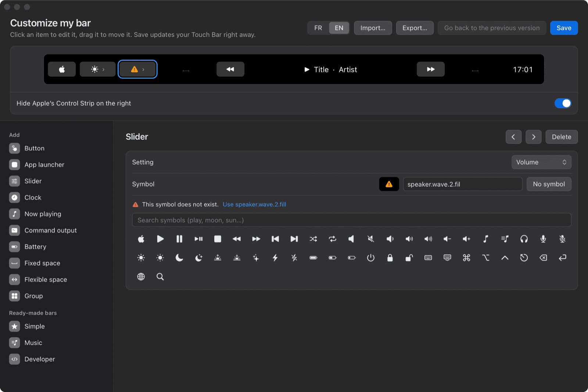

<p align="center">
  
</p>

<h1 align="center">Tactile</h1>

<p align="center">
  <strong>A free, open-source Touch Bar for your MacBook Pro, described in a small text file or set up in a window.</strong>
</p>

<p align="center">
  <a href="https://github.com/lepalph/tactile-touch-bar/actions/workflows/ci.yml"></a>
  <a href="https://github.com/lepalph/tactile-touch-bar/releases/latest"></a>
  <a href="LICENSE"></a>
  
</p>

<p align="center">🇫🇷 <a href="README.fr.md">Lire en français</a></p>

Tactile replaces your MacBook Pro's Touch Bar with the bar you want: buttons, brightness and volume sliders, the track that's playing, a clock, your own commands. One tap switches between your bar and Apple's.


## Highlights

- Your bar lives in `~/.config/tactile/barre.toml`, one `[[item]]` per item. Save the file and the bar updates within a second. A mistake leaves your current bar in place, and the error names the line.
- The editor window (`tactile --customize`) shows the Touch Bar at real size. You drag items around, pick symbols and colors, and it writes that same file.
- A `type = "script"` item runs any shell command every `interval` seconds and shows what it prints. If the command prints JSON, it also picks its own symbol and colors.
- An `[[application]]` table gives an app its own bar while it is in front. With `inherit = true`, the edges of your main bar (sliders, clock) stay put. A `[[site]]` table does the same for a website: on YouTube, your own play and skip buttons.
- Sliders come in seven styles (`grid`, `gauge`, `dots`, `equalizer`, `stepper`, `dial` and Apple's `classic`), with per-level colors and haptics, and can drive any command; a `choice` is a segmented picker.

  
- A button can send a shortcut (`action = { key = "cmd+shift+4" }`, resolved on your keyboard layout, AZERTY included), open an app or a URL, or run AppleScript or a shell command. `long_press` gives it a second action.
- A `launcher` shows an app's real icon, with a dot while the app runs; put a few in a `group` and you have an app drawer. A `[[source]]` feeds live text from a URL, a command or an MCP tool (the weather, a build status), and API keys stay in the macOS keychain.

| Pick a symbol for the app drawer, add Mail to it, save | Put your own logo on a button, then make it monochrome |
|---|---|
|  |  |

## A bar in ten lines

```toml
[[item]]
type = "script"
command = "date +%A"
interval = 60

[[item]]
type = "button"
symbol = "camera.viewfinder"
action = { key = "cmd+shift+4" }
long_press = { app = "Screenshot" }
```

The full reference is [further down](#configuration-reference).

## Roadmap

Tactile is built for its author's own use first, so the order below follows what he needs. Where it's heading is described in [docs/VISION.md](docs/VISION.md) (in French).

| What | Status |
|---|---|
| App launchers, app drawer and system shortcuts (Mission Control, Spotlight, screenshots…) | Done (0.3.0) |
| Import and export a bar (`.toml`, or `.zip` with its logos) | Done (0.3.0) |
| Your own logos on buttons | Done (0.3.0) |
| Data sources for live items: HTTP, commands, MCP servers | Done (0.3.0) |
| Slider styles, free-standing slider and choice picker | Done (0.4.0) |
| A bar per website | Done (0.4.0) |
| Edit per-app and per-site bars in the editor | Done (0.4.0) |
| Web link with its logo and shortcut recorder in the editor | Done (0.4.0) |
| Modules: a widget is a program in any language that talks JSON with Tactile | Planned |
| A community gallery of bars and modules, checked in CI by `tactile --check` | Planned, after the building blocks |

If you want to help, the [good first issues](https://github.com/lepalph/tactile-touch-bar/labels/good%20first%20issue) are small and come with the files to look at. Before you start on a roadmap item, open an issue so two people don't write the same thing.

## Why Tactile

If you have used [BetterTouchTool](https://folivora.ai) or [MTMR](https://github.com/Toxblh/MTMR), you know the idea. Tactile does less, on purpose:

- It's free and MIT licensed, with no license to renew and no account, and it sends nothing anywhere. BetterTouchTool is a paid app that also handles gestures, window snapping and more; Tactile only does the Touch Bar.
- It's small. The bar is native Rust and runs no Electron or web runtime. With the default bar it idles at 0.0 to 0.2 % CPU and 14 MB of memory (measured with `top` on a 13-inch M1 running macOS 15.8). The v0.4.0 download is a 3 MB zip.
- Your bar is a text file you can keep in version control: `~/.config/tactile/barre.toml`. Save it and the bar updates within a second. If you make a mistake, your current bar stays and the error tells you which line to fix.
- If you'd rather not edit a file, the "Customize my bar" window shows your Touch Bar at real size, lets you drag items around, and writes the same file.
- A group or a slider opens a real sub-bar with a ✕ to close it. MTMR uses popovers, which don't open in a system-wide bar ([why](docs/DECISIONS.md)).

## Compatibility

| | |
|---|---|
| Mac | MacBook Pro with a Touch Bar: Intel (2016 to 2020) or Apple Silicon (M1 and M2, 13-inch) |
| macOS | 13 Ventura or later |
| Tested on | 13-inch M1 MacBook Pro, macOS 15.8. The Intel build has only been tested under Rosetta, not on a real Intel Mac yet; reports are welcome. |

The app is a universal binary (Apple Silicon and Intel in one `Tactile.app`).

## Install

1. Download `Tactile.zip` from the [latest release](https://github.com/lepalph/tactile-touch-bar/releases/latest) and unzip it.
2. Drag `Tactile.app` into **Applications**.
3. Open it once by hand. The app isn't notarized by Apple, so macOS blocks the first launch:
   - **macOS 15 Sequoia and later:** double-click Tactile. macOS says it "could not verify" the app; click **Done** (not Move to Trash). Open **System Settings → Privacy & Security**, scroll to the bottom, click **Open Anyway** and confirm with Touch ID or your password. You only do this once.
   - **macOS 13 and 14:** right-click `Tactile.app` → **Open**, then **Open** again.
   - **Or, from Terminal, on any version:** `xattr -d com.apple.quarantine /Applications/Tactile.app`, then open the app normally.
4. Your Touch Bar changes, and an icon appears in the menu bar at the top of the screen.

Why not notarized: notarization needs a paid Apple developer account, which this project doesn't have. The app is signed ad hoc, and each new release lists the SHA-256 of the zip.

Optional:

- To show the track that's playing: `brew install media-control` ([why](#why-media-control)).
- For simulated keys (the `echap`, `touche` and `keycode` actions), allow Tactile in **System Settings → Privacy & Security → Accessibility**.

Tactile asks for nothing else at launch. The microphone prompt only appears if you install the [Claude voice extra](#claude-voice-extra).

## Quick start

### The menu

Everything starts from the menu bar icon. The menu is in French for now; here is what each item does:

| Menu item | What it does |
|---|---|
| Personnaliser ma barre… (*Customize my bar*) | Opens the editor window below. No need to touch the file. |
| Afficher ma barre (*Show my bar*) | Brings your bar back if it went away. |
| Barre d'Apple (*Apple's bar*) | Shows Apple's bar; the ✳ icon in the Control Strip brings yours back. |
| Ouvrir la configuration (*Open the configuration*) | Opens your bar file (created if it doesn't exist). |
| Voir le journal (*View the log*) | Opens `~/Library/Logs/Tactile.log`: config errors, failing scripts. |
| Lancer au démarrage (*Launch at login*) | Starts Tactile with your session. |
| Quitter Tactile (*Quit Tactile*) | Gives the Touch Bar back to Apple and quits. |

### Customize my bar

Choose **Personnaliser ma barre…** in the menu. The window shows your Touch Bar at the top, at its real size. Its language follows your Mac; the FR / EN switch is at the top right.

- **Add** (left column): one click adds a button, an app launcher, a text, the weather, a slider, the clock, now playing, a command's output, the battery, a space or a group. The three **ready-made bars** (Simple, Music, Developer) replace your bar with a template you can then adjust.
- **In the preview**, click an item to edit it and drag it to move it. With the keyboard: arrows move the selection, ⌥ + arrows move the item, ⌫ removes it (the "Undo" link or ⌘Z puts it back). Whatever won't fit on the Touch Bar is faded and struck through, with "2 items don't fit" under the preview.
- **Weather…**: type a city name and pick it from the list; the window adds a text with the temperature and a weather symbol, plus the Open-Meteo source behind it. Only the city name goes over the network, and only when you click **Search**. **Sources**, under **Data**, lists your bar's data sources: name, web address or command, interval; a Text item picks its source from a list.

  
- **On the right**, the selected item's settings: text, symbol (search the list or type an exact SF Symbol name), background and text colors, text size, symbol only or text only, width, and what a tap does: open an app (**Choose…** opens your Applications folder), open a web address, send a keyboard shortcut (`cmd+shift+4`), run a shell command or an AppleScript, or a system action (brightness, volume, playback…). A long press can do something else. Settings the window can't edit yet (a `keycode`) are kept as they are when you save.
- To put your own logo on a button, click **Choose an image…** or drop the file onto the button; it is copied to `~/.config/tactile/icones/` (SVG, PDF and icns files become a PNG there) and can be shown monochrome, like Apple's symbols.
- An app name typed by hand is checked: if your Mac has no app by that name, the window says so under the field and offers the closest one ("Photoshop" → "Adobe Photoshop 2025"). The name the Finder shows in another language works too: "Musique" offers "Music", the name the bar needs. **Choose…** is still the safest way.
- A keyboard shortcut, the esc key or a screenshot action needs the Accessibility permission: the window says so under the action, with a button that opens the right System Settings pane. An image without a transparent background is flagged when you turn on monochrome (it would become a solid block).
- **Save** writes the file and the Touch Bar changes within a second. If something is wrong (a symbol that doesn't exist, a malformed color, an empty bar), nothing is written and the window tells you what to fix. What will work badly without blocking anything is shown after saving: "Saved, 1 warning: Figma isn't installed on this Mac." Until you save, "Edited" shows next to the title, and the window asks before closing, loading a ready-made bar or going back.
- **Go back to the previous version** (in the **⋯** menu at the top right, with **Export…** and **Import…**) steps back one save per click. The last 5 versions are kept next to your bar (`barre.toml.precedent`, then `.precedent-2` to `.precedent-5`); the version you leave moves to the end, so nothing is lost.
- If you wrote your file by hand with comments, the first save from the window keeps an untouched copy, `barre.toml.manuel`, which the window never overwrites.
- **Export…** saves your bar to share it or move it to another Mac: a `.toml` file, or a `.zip` holding `barre.toml` and the logos it uses when it has any. If you pick `.toml` for a bar with logos, the window offers the `.zip` instead.
- **Import…** (or drop a `.toml` or `.zip` anywhere in the window) shows the incoming bar at real size and lists everything it can run on your Mac: shell commands, AppleScript, keyboard shortcuts, script commands, apps it opens, addresses that aren't web pages, and what each data source runs or fetches (command, MCP server, URL). Nothing changes until you click **Replace my bar**; your current bar then goes into the history, so **Go back to the previous version** brings it back. Logos are redrawn as PNG into `icones/`. Archives with `..` paths, absolute paths or symbolic links are refused, as are archives over 10 MB, images over 2 MB and more than 200 files; anything other than `barre.toml` and `icones/` images is ignored.
- **Add to my bar**, next to **Replace my bar**, keeps your bar and appends the incoming items, their sources (renamed if the name is taken) and their app bars. The "a command can do anything" warning only shows when the incoming bar really runs a command or a script.
- A ready-made bar keeps your app bars and the sources they use.
- The **Edit** (Undo, Copy, Paste, Select All…), **File** (Close ⌘W) and **View** (Zoom In ⌘+, Zoom Out ⌘−, Actual Size ⌘0) menus work as in any Mac app; the zoom level is kept, and the window stays usable at 200%.
- If your file has an error, the window doesn't show an empty bar: it shows the faulty line and turns Save off. You can **open the file** to fix it, then **reload** it, or **start from a ready-made bar**; your file is then first copied to `barre.toml.abime-YYYYMMDD-HHMMSS`.

To open the window on its own, without taking over the Touch Bar: `tactile --customize` (or `--personnaliser`).

### Edit the file by hand

The window writes `~/.config/tactile/barre.toml`, with a short header. You can switch between the window and the file whenever you like. Choose **Ouvrir la configuration** in the menu to open it. Each `[[element]]` block (or `[[item]]`, in English) is one item on the bar, left to right; both can be mixed in one file and keep the order of the file. Save, and the bar changes within a second.

For example, a button that puts the Mac to sleep, and opens Activity Monitor if you hold it:

```toml
[[item]]
type = "button"
symbol = "moon.fill"
text = "Sleep"
color = "#3A3A3C"
action = "sleep"
long_press = { shell = "open -a 'Activity Monitor'" }
```

Symbols are Apple's [SF Symbols](https://developer.apple.com/sf-symbols/): `moon.fill`, `play.fill`, `bolt.fill`… A misspelled symbol shows its name as text.

If the file has an error, your current bar stays, a red "⚠ config ligne N" item (*config line N*) appears at the start of the bar until you fix it, and the error goes to the log (menu → Voir le journal). To check a file without touching the bar: `tactile --check` (or `tactile --check other.toml`). Beyond the syntax, it warns about what would break in use: an unknown SF Symbol, a color that isn't `#RRGGBB`, a missing image or app, a bar that overflows.

## Configuration reference

The French keys are the canonical form, the one the editor writes and the error messages use. Every key, type, setting and action also has an English alias, and you can mix both in one file. Below, each name is given as `french` / `english`; see the [glossary](#english-aliases) for the full list.

### Top-level setting

`animation_demarrage` / `startup_animation` (`true` by default) plays a short animation (about 0.9 s) when Tactile starts, not on each reload: the logo appears in the middle of the bar and splits apart, then the items come out from the center toward the edges. It is skipped when macOS "Reduce motion" is on, and can be turned off with the switch at the top of the editor. An animated GIF (`image = "~/x.gif"`, at most 60 frames and 2 MB) animates on the bar; a GIF used as a template is not tinted.

`masquer_control_strip` / `hide_control_strip`, at the top of the file, `true` by default. `true` gives your bar the full width (1004 points). `false` keeps Apple's Control Strip on the right, which leaves 685 points and adds a system ✕ on the left.

A button, the clock or now playing without a `largeur` / `width` is capped at 200 points (the text is cut with …). Whatever doesn't fit in the bar is not shown, and the log says so ("la barre principale déborde … n éléments seront cachés": *the main bar overflows, n items will be hidden*).

### Elements

| `type` | Fields | What it shows |
|---|---|---|
| `bouton` / `button` | `texte` / `text`; `symbole` / `symbol` (an SF Symbol name) or `image` (path to a PNG, PDF, icns…; `~` works; `gabarit` / `template` = `true` for a monochrome image tinted like a symbol); `couleur` / `color` (background, `"#RRGGBB"`); `couleur_texte` / `text_color`; `taille` / `size` (font size in points); `affichage` / `display`: `"icone"` / `"icon"`, `"texte"` / `"text"` or `"les_deux"` / `"both"` (default); `largeur` / `width` (points); `action`; `appui_long` / `long_press` (an action, after 0.5 s) | A button. Every field is optional. With both a symbol and an image, the image shows. An image that can't be found shows as text, like an unknown symbol. |
| `slider` (or `curseur`) | `reglage` / `setting` (`"luminosite"` / `"brightness"` or `"volume"`) **or** `regler` / `set` (a command with `{valeur}`); `symbole` / `symbol`, `style`, `couleurs` / `colors` and `seuils` / `thresholds`, `crans` / `notches`, `haptique` / `haptic`; with `set`: `lire` / `read`, `min`, `max`, `pas` / `step`, `toutes_les` / `every` (see [Sliders](#sliders)) | A button that opens a sub-bar with a slider; ✕ closes it. |
| `choix` / `choice` | `options` (a list of texts), `action`, `lire` / `read`, `toutes_les` / `every` (5 s by default), `largeur` / `width` | A segmented picker. The option you tap replaces `{valeur}` in the action, single-quoted for the shell (double-quoted in an AppleScript): `action = { shell = "echo {valeur} > ~/speed" }`. `read` prints the current option, which then shows as selected. |
| `heure` / `clock` | `format` (an Apple date format, `"HH:mm"` by default) | The time, kept up to date. |
| `en_cours` / `now_playing` | `largeur` / `width` | Title and artist of what's playing (44 characters at most, refreshed every 2 s); a tap pauses or resumes. Needs `media-control`. |
| `script` | `commande` / `command` (required); `intervalle` / `interval` (seconds, required; values below 0.1 are raised to 0.1); `delai` / `timeout` (seconds, 5 by default); `largeur` / `width` (120 by default); `action` | The output of the command, run with `zsh -c` at every interval and killed after `delai`. Text wider than the item is cut. A non-zero exit code or anything on stderr writes a line to the log. If the output starts with `{`, it is read as JSON: `{"texte": "12°", "symbole": "cloud.rain.fill", "image": "~/rain.png", "couleur": "#1F3A5F", "couleur_texte": "#FFFFFF"}`, every key optional (English keys work too: `text`, `symbol`, `color`, `text_color`). That's how a script sets its own icon and colors. |
| `texte` / `text` | `source` (the `nom` / `name` of a `[[source]]`); `gabarit` / `template` (`"{current.temperature_2m} °C"`, `{texte}` by default); `symbole_selon` / `symbol_by`; `couleur_selon` / `color_by`; `largeur` / `width` (120 by default); `action` | A value from a [data source](#data-sources), refreshed with it. |
| `batterie` / `battery` | `symbole` / `symbol` (`true` by default: a battery icon next to the percentage, with a bolt while charging; `false`: text only, `⚡ 85 %` while charging); `largeur` / `width` (96 by default) | The battery level, read every 30 s (`pmset -g batt`). |
| `espace` / `space` | `largeur` / `width` (required) | Empty space of a fixed width. |
| `souple` / `flexible` | none | Empty space that takes all the room left: two `souple` center what's between them. |
| `groupe` / `group` | `texte` / `text`, `symbole` / `symbol`, `largeur` / `width` (72 by default), then sub-items `[[element.element]]` / `[[item.item]]` | A button that opens a sub-bar with its items; ✕ closes it. |
| `lanceur` / `launcher` | `app` (required: the `.app` folder name, a bundle id or a path, like the `app` action); `texte` / `text`; `affichage` / `display` (as for a button); `largeur` / `width`; `appui_long` / `long_press` | The app's own icon. A tap opens the app or brings it to the front; a small dot under the icon means it's running, as in the Dock. An app that can't be found shows its name as text, and `tactile --check` warns about it. |


#### Sliders

A slider sets the built-in display's brightness or the volume (`setting`), or anything else a command can set (`set`):

- `set` runs with `zsh -c` as your finger moves, at most every 0.1 s, then once more when you lift it. `{valeur}` (or `{value}`) becomes the chosen number, written with as many decimals as `step`: never text, so nothing else can get into the command.
- `read` prints the current value (a number). Tactile runs it when the slider opens, then every `every` seconds (5 by default, 0.5 at least) while it stays open.
- `min` (0), `max` (100) and `step` (1) bound the value. Brightness and volume go from 0 to 100 %.
- `style`: `classic` (Apple's slider, the default), `grid` (bars that light up), `gauge`, `dots`, `equalizer` (bars that grow taller), `stepper` (big digits, − and +, a long press repeats) or `dial` (a compact ring; swipe left or right).
- `colors` and `thresholds`: one color per level, one more color than thresholds, in the slider's own units. `colors = ["#30D158", "#FFD60A", "#FF453A"]` with `thresholds = [60, 85]` gives green, yellow from 60, red from 85. A single color paints the whole slider. Without `colors`, white.
- `notches`: how many bars or dots (10 by default, 2 to 40). `haptic = true`: a small trackpad click at each notch.

| | |
|---|---|
| `classic` |  |
| `grid` |  |
| `gauge` |  |
| `dots` |  |
| `equalizer` |  |
| `stepper` |  |
| `dial` |  |

```toml
# Spotify's volume, without touching the Mac's.
[[item]]
type = "slider"
symbol = "music.note"
read = "osascript -e 'if application \"Spotify\" is running then tell application \"Spotify\" to get sound volume'"
set = "osascript -e 'if application \"Spotify\" is running then tell application \"Spotify\" to set sound volume to {value}'"
step = 5
style = "equalizer"
colors = ["#30D158", "#FFD60A", "#FF453A"]
thresholds = [60, 85]
```

More templates (Music's volume, an external display through `m1ddc`, a `choice`): [exemples/curseurs.toml](exemples/curseurs.toml). In the editor, a slider's panel shows the styles as live thumbnails, the per-level colors and these templates.
#### An app drawer

Launchers in a group make an app drawer: one icon in the main bar opens a sub-bar of apps, ✕ closes it. A full French example is in [exemples/lanceur.toml](exemples/lanceur.toml).

```toml
[[item]]
type = "launcher"
app = "Safari"

[[item]]
type = "group"
symbol = "square.grid.2x2"

  [[item.item]]
  type = "launcher"
  app = "Calendar"

  [[item.item]]
  type = "launcher"
  app = "com.apple.systempreferences"
  text = "Settings"
  long_press = "launchpad"
```

### Actions

An action is either a word (`action = "next"`) or a table (`action = { volume = 0.3 }`).

| Action | What it does |
|---|---|
| `"luminosite_plus"` / `"brightness_up"`, `"luminosite_moins"` / `"brightness_down"` | Built-in display brightness, one step (1/16). |
| `{ luminosite = 0.5 }` / `{ brightness = 0.5 }` | Sets the brightness, from 0 to 1. |
| `"volume_plus"` / `"volume_up"`, `"volume_moins"` / `"volume_down"` | Output volume, one step (1/16). |
| `{ volume = 0.3 }` | Sets the volume, from 0 to 1. |
| `"basculer_muet"` / `"toggle_mute"` | Mutes or unmutes. |
| `"lecture_pause"` / `"play_pause"`, `"suivant"` / `"next"`, `"precedent"` / `"previous"` | Controls whatever is playing, in any app (needs `media-control`). |
| `"veille"` / `"sleep"` | Puts the Mac to sleep (`pmset sleepnow`). |
| `"echap"` / `"esc"` | Sends the esc key (needs the Accessibility permission). |
| `{ touche = "cmd+shift+4" }` / `{ key = "cmd+shift+4" }` | Sends a keyboard shortcut (Accessibility). Modifiers: `cmd` (or `command`), `shift` (or `maj`), `ctrl` (or `control`), `alt` (or `option`), `fn`. Key: a letter, digit or symbol from your keyboard (resolved on your current layout, AZERTY included; `+` and `-` too, as in `cmd++`), `f1` to `f20`, `esc`, `tab`, `space`, `enter`, `delete`, `left`, `right`, `up`, `down`, `home`, `end`, `pageup`, `pagedown` (French names work too: `espace`, `entree`, `suppr`, `gauche`…). |
| `{ keycode = 53 }` | Sends a key by its macOS key code, for keys that have no name. |
| `{ app = "Figma" }` | Opens an app by name or bundle identifier (`com.figma.Desktop`), like `open -a`. See [finding an app's name](#finding-an-apps-name). |
| `{ url = "https://…" }` | Opens the address in the default browser (or a file, or a folder). |
| `{ applescript = 'tell application "Music" to playpause' }` | Runs the AppleScript with `osascript`. With single quotes around it, the script's double quotes stay readable. Errors go to the log. |
| `"barre_apple"` / `"apple_bar"` | Shows Apple's bar; the ✳ icon in the Control Strip brings Tactile's back. |
| `"mission_control"`, `"fenetres_app"` / `"app_windows"`, `"bureau"` / `"show_desktop"` | Mission Control, the front app's windows (App Exposé), or the desktop, through Apple's Mission Control app. |
| `"launchpad"` | Opens Launchpad. |
| `"capture_options"` / `"screenshot_options"` | The screenshot and screen recording toolbar (⌘⇧5), through Apple's Screenshot app. |
| `"spotlight"`, `"capture_ecran"` / `"screenshot"`, `"capture_zone"` / `"screenshot_area"`, `"emojis"` / `"emoji"`, `"verrouiller"` / `"lock_screen"`, `"forcer_quitter"` / `"force_quit"` | Spotlight (⌘Space), a screenshot of the whole screen (⌘⇧3) or of an area (⌘⇧4), the emoji and symbols viewer (⌃⌘Space), lock the screen (⌃⌘Q), the Force Quit window (⌥⌘⎋). Sends macOS's default shortcut (Accessibility); if you changed it in System Settings, use `{ key = "…" }` with yours. |
| `{ shell = "command" }` | Runs the command with `zsh -c`, without waiting for it to finish. `~` works. |

#### Finding an app's name

`app` takes the name of the `.app` folder in Applications, without the extension, in English when the app has an English name: `"TextEdit"`, `"Activity Monitor"`, `"DaVinci Resolve"`. To read it, right-click the app in Finder → Get Info; the name at the top is the one to use. If two apps share a name, the bundle identifier is safer: `osascript -e 'id of app "Figma"'` prints it (`com.figma.Desktop`). An app that can't be found is reported by `tactile --check` and in the log. A bundle id works too: it is opened with `open -b`.

### English aliases

French is the reference form, but you can write the whole file in English, which helps when you share a bar with someone who doesn't read French. Both forms can be mixed in one file, `[[element]]` and `[[item]]` included: the items keep the order in which they are written. Error messages stay in French for now (see [Troubleshooting](#troubleshooting)).

| French | English |
|---|---|
| `masquer_control_strip` | `hide_control_strip` |
| `animation_demarrage` | `startup_animation` |
| `element` | `item` |
| `bouton` | `button` |
| `heure` | `clock` |
| `en_cours` | `now_playing` |
| `espace` | `space` |
| `souple` | `flexible` |
| `groupe` | `group` |
| `batterie` | `battery` |
| `texte` | `text` |
| `symbole` | `symbol` |
| `gabarit` | `template` |
| `couleur` | `color` |
| `couleur_texte` | `text_color` |
| `taille` | `size` |
| `affichage` | `display` |
| `icone` | `icon` |
| `les_deux` | `both` |
| `largeur` | `width` |
| `appui_long` | `long_press` |
| `reglage` | `setting` |
| `luminosite` | `brightness` |
| `commande` | `command` |
| `intervalle` | `interval` |
| `delai` | `timeout` |
| `luminosite_plus` | `brightness_up` |
| `luminosite_moins` | `brightness_down` |
| `volume_plus` | `volume_up` |
| `volume_moins` | `volume_down` |
| `basculer_muet` | `toggle_mute` |
| `lecture_pause` | `play_pause` |
| `suivant` | `next` |
| `precedent` | `previous` |
| `veille` | `sleep` |
| `echap` | `esc` |
| `barre_apple` | `apple_bar` |
| `touche` | `key` |
| `slider` | `slider` |
| `script` | `script` |
| `format` | `format` |
| `image` | `image` |
| `action` | `action` |
| `volume` | `volume` |
| `shell` | `shell` |
| `keycode` | `keycode` |
| `app` | `app` |
| `url` | `url` |
| `applescript` | `applescript` |
| `herite` | `inherit` |
| `adresse` | `address` |
| `lanceur` | `launcher` |
| `mission_control` | `mission_control` |
| `fenetres_app` | `app_windows` |
| `launchpad` | `launchpad` |
| `bureau` | `show_desktop` |
| `spotlight` | `spotlight` |
| `capture_ecran` | `screenshot` |
| `capture_zone` | `screenshot_area` |
| `capture_options` | `screenshot_options` |
| `verrouiller` | `lock_screen` |
| `emojis` | `emoji` |
| `forcer_quitter` | `force_quit` |
| `source` | `source` |
| `nom` | `name` |
| `http` | `http` |
| `toutes_les` | `every` |
| `entetes` | `headers` |
| `mcp` | `mcp` |
| `outil` | `tool` |
| `arguments` | `arguments` |
| `symbole_selon` | `symbol_by` |
| `couleur_selon` | `color_by` |
| `champ` | `field` |
| `valeurs` | `values` |
| `defaut` | `default` |
| `seuils` | `thresholds` |
| `couleurs` | `colors` |
| `curseur` | `slider` |
| `lire` | `read` |
| `regler` | `set` |
| `pas` | `step` |
| `crans` | `notches` |
| `haptique` | `haptic` |
| `classique` | `classic` |
| `grille` | `grid` |
| `jauge` | `gauge` |
| `points` | `dots` |
| `egaliseur` | `equalizer` |
| `pas_a_pas` | `stepper` |
| `cadran` | `dial` |
| `choix` | `choice` |

In a `script`'s JSON output too: `text`, `symbol`, `color`, `text_color`.

### A complete example in English

This is Tactile's default bar written with English keys, from [exemples/barre.en.toml](exemples/barre.en.toml). Copy it to `~/.config/tactile/barre.toml` to start from it.

```toml
# Hide Apple's strip of system buttons, on the right.
hide_control_strip = true

# Show Apple's bar (per-app buttons); the ✳ icon in the Control Strip brings this one back.
[[item]]
type = "button"
symbol = "apple.logo"
width = 56
action = "apple_bar"

# Screen brightness slider.
[[item]]
type = "slider"
setting = "brightness"
symbol = "sun.max.fill"

# Volume slider.
[[item]]
type = "slider"
setting = "volume"
symbol = "speaker.wave.2.fill"

# Flexible space: pushes what follows towards the centre.
[[item]]
type = "flexible"

# ⏪ Previous track.
[[item]]
type = "button"
symbol = "backward.fill"
action = "previous"

# Now playing (width in points).
[[item]]
type = "now_playing"
width = 330

# ⏩ Next track.
[[item]]
type = "button"
symbol = "forward.fill"
action = "next"

# Flexible space: pushes what follows to the right.
[[item]]
type = "flexible"

# Clock (HH = hours, mm = minutes).
[[item]]
type = "clock"
format = "HH:mm"
```

The other examples in [exemples/](exemples/) are in French: [simple.toml](exemples/simple.toml) and [developpeur.toml](exemples/developpeur.toml) are the editor's Simple and Developer bars, [lanceur.toml](exemples/lanceur.toml) shows launchers, an app drawer and system shortcuts.

## Data sources

A `[[source]]` fetches a value (the weather, a server's status, the result of an MCP tool); a `texte` / `text` element, or a button with a `source`, shows it. Tactile reads nothing before the bar is on screen, never on the UI thread, and never more often than `toutes_les` / `every`.

```toml
[[source]]
name = "weather"
http = "https://api.open-meteo.com/v1/forecast?latitude=48.85&longitude=2.35&current=temperature_2m,weather_code"
every = 600                 # seconds, 60 by default, 5 at least

[[item]]
type = "text"
source = "weather"
template = "{current.temperature_2m} °C"
symbol_by = { field = "current.weather_code", values = { "0" = "sun.max.fill", "3" = "cloud.fill", "61" = "cloud.rain.fill" }, default = "cloud.sun.fill" }
color_by = { field = "current.temperature_2m", thresholds = [10, 25], colors = ["#0A84FF", "#30D158", "#FF9F0A"] }
```

- A source has a `nom` / `name` and **exactly one** of:
  - `http = "https://…"`: fetched with `/usr/bin/curl`, 10 s and 1 MB at most, redirects not followed. Only `https://` and `http://localhost` (or `127.0.0.1`) are allowed. `entetes` / `headers = { Authorization = "Bearer trousseau:openweather" }` adds headers.
  - `commande` / `command = "…"`: run with `zsh -c`, like a `script` (10 s at most).
  - `mcp = { commande = "npx -y @modelcontextprotocol/server-xyz", outil = "get_weather", arguments = { city = "Paris" } }` (`command`, `tool` in English): an MCP server over stdio, started once and kept alive; Tactile calls the tool (`tools/call`) every `toutes_les` seconds. `mcp = { url = "https://…/mcp", outil = "…" }` targets a remote server (Streamable HTTP). Both protocol eras work: 2026-07-28 (`server/discover`) and older servers (`initialize`). A server that dies is restarted after 5 s, then 10, 20… up to 5 min.
- The value is JSON (HTTP body, command output, the tool's `structuredContent` or `content[0].text`). Anything that isn't JSON is read with `{texte}` (or `{text}`).
- `gabarit` / `template` replaces each `{path}` with the value at that path: `a.b.c`, and a number for a list item (`hourly.time.0`). A missing field shows `—` and writes one line to the log (once, not at every read). A failing source shows `⚠ source`; the error is in the log.
- `symbole_selon` / `symbol_by` picks an SF Symbol from the value of a `champ` / `field` (`valeurs` / `values`, else `defaut` / `default`). `couleur_selon` / `color_by` picks the background color: the first color below the first threshold, the next one up to the following threshold, and so on (one more color than thresholds).
- A button can have a `source` too: its `texte` / `text` becomes the template (`gabarit` / `template` already means the monochrome image there).
- **Secrets**: don't write a key in the file. Put it in the keychain (`security add-generic-password -s openweather -a "$USER" -w`), then write `trousseau:openweather`: Tactile replaces it with the password at each read (macOS may ask for permission the first time). The key is never written to the log or to a message, and reaches `curl` through its standard input, not its command line. `tactile --check` warns about a header that looks like a plain-text key.
- `tactile --check` also reports an unknown source, a duplicate name, a refused address, an interval under 5 s, a `gabarit` without a source and a template variable that can't exist (`{Text}`, `{a..b}`).
- The processes (`curl`, command, MCP server) are killed when the bar reloads and when Tactile quits. Started from the Finder, the PATH lacks `/opt/homebrew/bin`: write the full path (`/opt/homebrew/bin/npx`).

Examples: [exemples/meteo.toml](exemples/meteo.toml) (Open-Meteo, Paris, symbol from the WMO weather code) and [exemples/mcp.toml](exemples/mcp.toml) (the tiny demo MCP server [exemples/mcp/horloge-mcp.py](exemples/mcp/horloge-mcp.py)).

## A bar per app

An `[[application]]` table gives an app its own bar: when that app comes to the front, its bar replaces the main one, and the main bar comes back when you leave it. The `[[element]]` entries at the top of the file stay the main bar.

```toml
[[application]]
app = "com.apple.Safari"        # bundle id, or display name ("Safari")
inherit = true                  # default false

[[application.item]]
type = "button"
text = "New tab"
action = { key = "cmd+t" }
```

- `app`: the app's bundle id or its display name, case-insensitive. The bundle id is the safer choice; to find it, run `osascript -e 'id of app "Safari"'` (prints `com.apple.Safari`).
- `inherit = false` (default): the app's items replace the whole bar. `inherit = true`: they only replace the area between the first and the last `flexible` space of the main bar, so what sits before and after (brightness, clock…) stays. If the main bar has no `flexible` space, they are appended to it.
- Each `[[application.item]]` is written like an `[[item]]`; a group takes its children as `[[application.item.item]]`. An `[[application]]` without `app` or without items is rejected, with its line number. An `[[item]]` written after an `[[application]]` still goes to the main bar: `tactile --check` warns about it, since you probably meant `[[application.item]]`. It also warns when two `[[application]]` tables name the same app (only the first one is used) and when an app's bar overflows.
- An open sub-bar (slider, group) stays put when you switch apps; its ✕ brings back the bar of the frontmost app. The ✳ icon also brings back the current app's bar.

Full example: [exemples/par-application.toml](exemples/par-application.toml). The "Customize my bar" window edits these bars too, in its **Bars** section.

## A bar per website

A `[[site]]` table gives a website its own bar: while the active tab of the browser in front is on that site, its bar wins over the app's bar and over the main bar.

```toml
[[site]]
address = "youtube.com"         # the domain and its subdomains; or a pattern: "*.google.com/maps*"
inherit = true                  # like [[application]]

[[site.item]]
type = "button"
symbol = "playpause.fill"
action = { key = "k" }
```

- `address`: a domain, which also covers its subdomains (`youtube.com` matches `www.youtube.com` and `m.youtube.com`, not `notyoutube.com`), optionally followed by the start of a path (`github.com/lepalph`). With `*`, a pattern over "domain/path": `*.google.com/maps*` (`*` matches anything, even nothing). Case-insensitive; no `https://`, and what follows `?` or `#` is never read. The first matching `[[site]]` wins. `tactile --check` warns about an empty address, an invalid pattern and two `[[site]]` tables for the same address.
- Browsers: Safari, Google Chrome, Arc, Brave, Microsoft Edge, Vivaldi and Chromium. Tactile reads the active tab only while one of them is in front and your file has a `[[site]]`: every 0.5 s, through AppleScript run inside Tactile on a thread of its own (1 s at most per read). Switching to another app stops the reads.
- Permission: the first time, macOS asks "Tactile wants to control Safari" (Automation). Answer OK. If you said no, the site bars stay hidden in that browser, its bar shows a small "⚠ site" button that opens the right settings pane, and `tactile --check` says so: System Settings → Privacy & Security → Automation → Tactile.
- Privacy: Tactile keeps only "domain/path" of the active tab, in memory. The address is never logged (only the domain of a refused or unreadable browser is named), never written to disk and never sent anywhere. An imported bar lists each of its `[[site]]` tables before you accept it ("changes the bar on youtube.com; reads the address of your browsers' active tab").
- An open sub-bar stays put when the tab changes; its ✕ brings back the current site's bar.

Full example (YouTube: play/pause `k`, forward `l`, back `j`, full screen `f`; Gmail: new message `c`): [exemples/par-site.toml](exemples/par-site.toml). The editor edits your `[[site]]` tables in its **Bars** section.

## Claude voice extra

A ✳ Claude button: you talk, and Claude Code answers out loud. Transcription (whisper.cpp) and the voice (Piper) run on your Mac; only the answer goes through Claude Code and your Claude account. The first time, macOS asks to give Tactile the microphone. Setup is in [extras/claude-voix](extras/claude-voix/README.md) (in French), and the items to add to your bar are in [exemples/claude-vocal.toml](exemples/claude-vocal.toml).

## For agents (MCP)

`tactile --mcp` turns Tactile into an MCP server (stdio), so an agent such as Claude Code can write on your Touch Bar. The Tactile app must be running: the server talks to it through a private socket (`~/Library/Application Support/Tactile/agent.sock`, folder mode 0700) and answers "Tactile n'est pas lancé" when it is not.

```
claude mcp add tactile -- ~/Applications/Tactile.app/Contents/MacOS/tactile --mcp
```

- `afficher {texte, duree_s = 5}` (1 to 60 s): a message over your bar, then your bar comes back. Does not wait.
- `demander {question, choix, delai_s = 120}` (5 to 600 s): a question with 1 to 4 buttons; waits and returns the label you touched, or `aucun` (time ran out, or you touched ✕).

Text is cut at 80 characters, button labels at 20. One request at a time: while one is on the bar, the next gets an `occupé` tool error right away and the agent retries. Nothing sent through the socket runs a command.

## Command line

The binary inside the app is `/Applications/Tactile.app/Contents/MacOS/tactile`.

| Command | What it does |
|---|---|
| `tactile` | Starts the bar (menu bar icon). |
| `tactile --customize` | Opens the "Customize my bar" window on its own, without taking over the Touch Bar. Same as `--personnaliser`. |
| `tactile --check [file]` | Checks a bar file without touching the Touch Bar. Same as `--verifier`. Without a file, checks your `barre.toml`. See below. |
| `tactile --export <file>` | Exports your bar: a `.toml`, or a `.zip` with its logos (`barre.toml` + `icones/`). Without an extension, picks the right one. Asking for a `.toml` when the bar has logos writes it with a warning: the logos stay as paths on this Mac. Same as `--exporter`. |
| `tactile --import <file> [--yes]` | Reads a `.toml` or `.zip`, checks it like `--check`, prints a summary and everything the bar can run, then asks before replacing your bar (the current one goes into the history). Without a terminal, it refuses unless you add `--yes`. Same as `--importer` and `--oui`. |
| `tactile --mcp` | MCP server on stdin/stdout, for agents (see above). The app must be running. |
| `tactile --version` | Prints the version. |
| `tactile --help` | Prints the help, in English, or in French when the system language is French (`LC_ALL`, `LANG`, then the macOS language). |

`tactile --check` reads the file like the bar does, then looks for what would break in use. A syntax error prints the file, its line and the reason, and exits with code 1. A problem the bar would survive prints a line starting with `attention :` (*warning:*) and exits with code 0: an unknown SF Symbol, a color that isn't `#RRGGBB`, a missing image, an app that isn't installed, a bar (main or per app) that overflows, two `[[application]]` tables for the same app, an `[[item]]` after an `[[application]]`. An empty bar is an error. When all is well, it prints `OK : n éléments` (*n items*), plus the number of app bars. The bar runs the same checks when it loads the file and writes the warnings to the log.

```
$ tactile --check barre.toml
attention : ligne 4 : la couleur « #F00 » doit s'écrire #RRGGBB : elle sera ignorée
attention : ligne 11 : cet [[element]] est écrit après un [[application]] : il va dans la barre principale ; voulais-tu [[application.element]] ?
OK : 2 éléments, 1 barre d'application
```

An unknown argument prints the help and exits with code 2. `TACTILE_CONFIG=/path/to/file.toml` replaces `~/.config/tactile/barre.toml` everywhere (bar, file watching, editor), which is handy to try things without touching your real bar. The other `TACTILE_*` variables are for development; see [CONTRIBUTING.md](CONTRIBUTING.md).

## Troubleshooting

Errors are written to `~/Library/Logs/Tactile.log` (menu → **Voir le journal**). They are in French for now. The common ones:

| In the log | Meaning |
|---|---|
| `ligne N : …` | line N: … |
| `valeur inconnue «x», attendu parmi …` | unknown value `x`, expected one of … |
| `champ inconnu «x»` | unknown field `x` |
| `champ manquant «x»` | missing field `x` |
| `type invalide` / `valeur invalide` | invalid type / invalid value |
| `symbole SF inconnu` / `image introuvable` | unknown SF Symbol / image not found (the item shows its name as text) |
| `la barre principale déborde … n éléments seront cachés` | the main bar overflows, n items will be hidden |
| `attention : …` | warning: the bar runs, but something will not show or work as written |
| `le symbole SF « x » n'existe pas` / `la couleur « x » doit s'écrire #RRGGBB` | unknown SF Symbol / the color must be written `#RRGGBB` (`#F00` and `red` are not accepted) |
| `app « x » introuvable` | app not found: neither a bundle id nor the name of an installed app |
| `cet [[element]] est écrit après un [[application]]` | this item comes after an `[[application]]` and goes to the main bar; did you mean `[[application.item]]`? |
| `« x » a déjà sa barre` | this app already has an `[[application]]` above; only the first one is used |
| `clé en double` / `texte entre guillemets mal fermé` | duplicate key / unclosed quoted string |
| `tué après 5 s` | (script) killed after 5 s |

| Problem | Fix |
|---|---|
| macOS won't open Tactile | See step 3 of [Install](#install): on macOS 15, **System Settings → Privacy & Security → Open Anyway**; or `xattr -d com.apple.quarantine /Applications/Tactile.app`. |
| My bar is gone and I see Apple's | Tap the ✳ icon in Apple's bar, or menu → Afficher ma barre. |
| My change doesn't show up | The file has an error. A red "⚠ config ligne N" item in the bar says so, and the log has the details. Open **Personnaliser ma barre…** and save: the error shows in the window. `tactile --check` checks the file from a terminal. |
| An item at the end disappeared | The bar overflows; `tactile --check` and the log say which bar and how many items are hidden. Reduce some `largeur` / `width` values or remove an item. |
| An item went to the main bar instead of an app's bar | It is written `[[item]]` after an `[[application]]`; write `[[application.item]]`. `tactile --check` points to its line. |
| A `script` stays empty | Its error is in the log (exit code, stderr, "tué après 5 s": *killed after 5 s*). When Tactile is started from Finder, `PATH` doesn't include `/opt/homebrew/bin`: write full paths to your tools. |
| Now playing stays empty | Install `media-control` (`brew install media-control`); something also has to be playing. |
| Esc or a shortcut does nothing | Allow Tactile in **System Settings → Privacy & Security → Accessibility**. |
| `{ app = "…" }` opens nothing | Use the `.app` folder's name ([finding an app's name](#finding-an-apps-name)); the log says "Unable to find application". |



### Why media-control

Since macOS 15.4, Apple stops apps from reading what's playing (the MediaRemote framework answers without doing anything). [media-control](https://github.com/ungive/media-control) goes through a program Apple still allows. Without it, the title stays empty and ⏪ ⏯ ⏩ do nothing; the rest of the bar works.

## Uninstall

1. Tactile menu → uncheck **Lancer au démarrage** (*Launch at login*), then **Quitter Tactile** (*Quit Tactile*).
2. Move `Tactile.app` to the Trash.
3. Remove your config and the log: `rm -r ~/.config/tactile ~/Library/Logs/Tactile.log`.

## Known limitations

- Tactile uses private Apple APIs (system-wide bar, Control Strip, brightness). A macOS update can break them; they are listed in [ARCHITECTURE.md](docs/ARCHITECTURE.md#api-privées-utilisées).
- The brightness slider only controls the built-in display.
- The menu and error messages are in French. `--help` and the editor window speak both.
- Not notarized (see [Install](#install)).
- Touch Bar gestures and trackpad gestures will come later (see [SPEC.md](SPEC.md), in French).

## Contributing

Contributions are welcome, in English or French. Identifiers and comments in the code are in French by project choice; [CONTRIBUTING.md](CONTRIBUTING.md) explains what that means for a pull request and has a short glossary of the identifiers you'll meet first.

Build from source (stable Rust; the repo ships a `mise.toml`):

```
cargo build --release      # target/release/tactile, to try it (--help, --version, --check)
CI=1 cargo test            # without CI=1, tests really change brightness and volume, then restore them
scripts/empaqueter.sh      # universal target/Tactile.app and target/Tactile.zip
scripts/verifier.sh        # drives every control on a real Touch Bar and checks the effect (screen on)
```

More in [CONTRIBUTING.md](CONTRIBUTING.md), [docs/ARCHITECTURE.md](docs/ARCHITECTURE.md) and [docs/DECISIONS.md](docs/DECISIONS.md) (both in French). Changes are listed in [CHANGELOG.md](CHANGELOG.md).

## Credits

- [MTMR](https://github.com/Toxblh/MTMR) (MIT), whose approach to the Touch Bar's private APIs served as the reference.
- [media-control](https://github.com/ungive/media-control), which makes now playing work again on recent macOS.

## License

[MIT](LICENSE). Do what you like with it.
